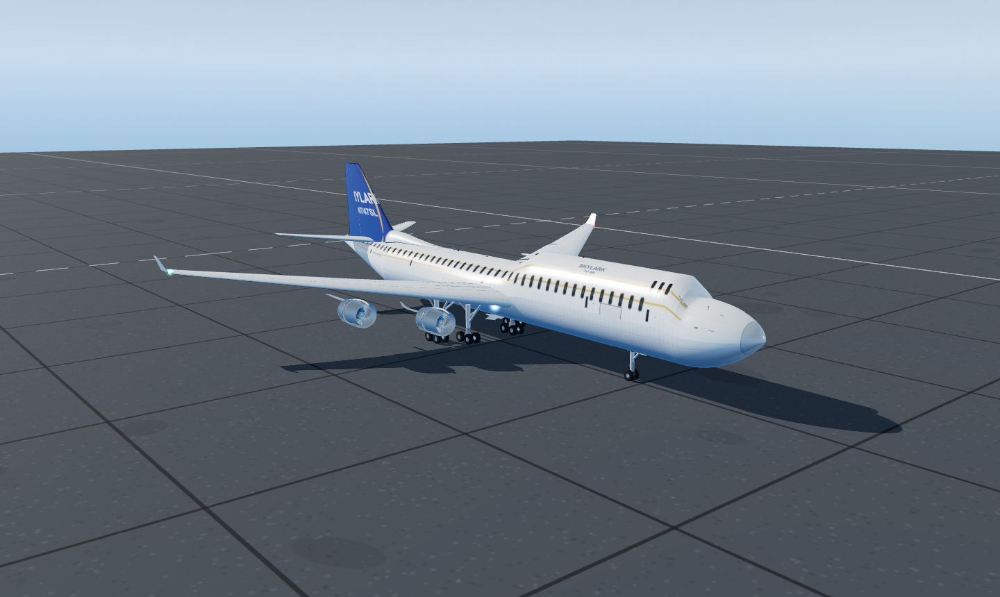

# Boeing 747-400 — procedural 3D model (HTML + JavaScript, three.js)

An ultra-detailed, fully procedural 747-400 that runs in any modern browser. Nothing is
imported: every surface, panel line, window, decal and texture is generated by code at
load time, so the whole aircraft is a single self-contained folder.

## Run it

ES modules cannot be loaded from `file://`, so serve the folder over http:

    start.cmd                 (Windows: starts the server and opens the browser)
    node serve.js             then open http://127.0.0.1:8147/index.html

Any static server works (`python -m http.server` from this folder, `npx serve`, ...).
Add `?clean=1` to the URL for a UI-free presentation view.

## Controls

| Group | What it does |
| --- | --- |
| View | 11 camera presets (or keys 1-9), auto-orbit |
| Configuration | landing gear up/down, Fowler flaps 0-40 deg, speedbrake/spoilers, thrust reversers, engine spool, exploded view |
| Flight controls | elevator, ailerons and rudder, plus a looping control check |
| Lights | navigation, strobes (flashing), anti-collision beacons, landing lights, cabin lighting |
| Livery | four painted schemes, each regenerating the fuselage, fin and panel textures and the decals |
| Display | hotspot labels (hover a chip for the description), wireframe, reset, save PNG |

## What is modelled

* **Fuselage** — analytic cross-section loft: elliptical/ogive radome, upswept tail cone,
  upper-deck hump, wing/body fairing grown into the section, 44 cabin windows per side at the
  real 1.256 m pitch, 3 upper-deck windows per side, 5 main-deck doors per side, upper-deck
  door, three cargo doors, four flight-deck glazing groups per side.
* **Wings** — 12-station supercritical-ish planform, 37.5 deg leading-edge sweep, 7 deg
  dihedral, 4 deg washout; leading-edge slats, inboard and outboard Fowler flaps, six
  spoiler panels, outboard ailerons, three flap-track canoe fairings, canted winglets.
* **Engines** — four high-bypass turbofans: cowl with a rounded intake lip, inner duct,
  translating reverser sleeve over cascade vanes, 38-blade fan on a spinner, core cowl,
  exhaust plug, accessory gearbox, oil tank, plumbing, faired pylon.
* **Empennage** — swept fin with dorsal fillet, rudder, horizontal stabiliser with elevators,
  APU exhaust cone.
* **Landing gear** — nose gear (2 wheels, steering actuators, torque link) and four four-wheel
  bogies (16 wheels) with shock struts, drag and side braces, retraction actuators, brake
  packs; wheel wells and doors that open and close with the gear.
* **Details** — VHF/TCAS/ADF blades, satcom dome, GPS pucks, pitot probes, angle-of-attack
  vanes, temperature probe, wipers, static dischargers, wing walkway lines, nav/strobe/beacon
  and landing lights with additive glow sprites.
* **Livery** — procedurally painted 2048x4096 fuselage maps (colour, Sobel-derived normal,
  packed roughness/metalness), 1024x1024 fin artwork, tiled wing and nacelle panel maps,
  curved skin-patch decals for the titles and registration.

Model space is metres, nose along +X, up +Y; the apron sits at y = -6.45 m, i.e. the wheels
rest on the ground.

## Layout

    index.html          page shell and control panel
    css/style.css       interface styling
    js/util.js          maths, lofts, lathes, airfoils, canvas/noise helpers
    js/fuselage.js      fuselage section maths, skin, windows, glazing, decal patches
    js/wings.js         wing surfaces, slats, flaps, spoilers, ailerons, winglets, canoes
    js/engines.js       nacelles, fans, cores, reversers, pylons
    js/tail.js          fin, dorsal fillet, rudder, stabiliser, elevators, APU
    js/gear.js          nose gear, main bogies, wheels, wells, doors
    js/details.js       aerials, probes, lights, decals, walkway lines
    js/materials.js     livery definitions and all procedural texturing
    js/aircraft.js      assembly + animation API + hotspot anchors
    js/scene.js         renderer, painted sky/IBL, apron, sun, camera presets
    js/main.js          boot, UI wiring, label projection, render loop
    lib/                three.js r160 (MIT) + OrbitControls, vendored for offline use
    qa/                 headless checks and the reference renders in qa/shots

## Verification

    node qa/smoke.mjs      geometry audit in plain Node (no browser): builds every subsystem
                           with stub materials and reports primitives, NaNs, outward-normal
                           audit and finite-difference checks of the analytic normals,
                           then exercises the animation API.
    node qa/shoot.mjs      boots the model in headless Chromium (SwiftShader), captures the
                           views in qa/shots and prints every console error.
    node qa/uicheck.mjs    drives the real interface (sliders, livery, presets) in headless
                           Chromium and captures qa/shots/ui-full.png and deployed.png.

The scripts expect puppeteer-core to be resolvable from
%TEMP%\dshrender (see the createRequire line at the top of each file); swap in any
headless Chromium by editing the CHROME list.

Last recorded run: 477 meshes, ~132k triangles, 0 NaN vertices, analytic normals agree with
finite differences to within 0.008, all control surfaces animate, no console errors.

## Credits

three.js r160 and OrbitControls are vendored under `lib/` (MIT licence, (c) three.js authors).
Everything else — geometry, textures, livery artwork, UI — is generated by the code in this folder.
