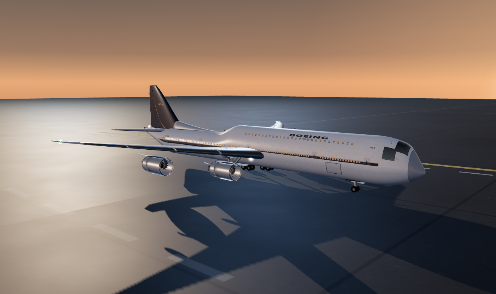

# Boeing 747-8 Intercontinental — procedural 3D model (HTML + JavaScript)

An ultra-detailed, fully procedural 747-8 that runs in any modern browser. Nothing is
downloaded at runtime: every surface, window, door, panel line, decal and texture is
generated by the code at load time, so the whole aircraft is one self-contained folder.

## Run it

ES modules cannot be loaded from `file://`, so serve the folder over http:

    start.cmd                 (Windows: starts the server and opens the browser)
    node serve.js             then open http://127.0.0.1:8147/

Any static server works (`python -m http.server`, `npx serve`, ...). Add `?clean=1` to
the URL for a UI-free presentation view.

## Controls

| Group | What it does |
| --- | --- |
| View | 14 camera presets (keys 1–9), auto-orbit, guided tour |
| Configuration | gear up/down, flaps 0–40°, speedbrake, thrust reversers, N1 spool, exploded view |
| Flight controls | elevator, ailerons, rudder, looping control check |
| Lights | navigation, strobes, beacons, landing lights, warm cabin glazing |
| Livery | four procedural schemes: House, Aurora Pacific, Pacific Retro, Obsidian VIP |
| Display | component labels, wireframe, reset, save PNG |

## What is modelled

* **Fuselage** — 76.3 m analytic double-bubble loft with the stretched upper deck, drooped
  radome, upswept tail cone and a wing/body belly fairing. 94 main-deck windows per side
  at the real 20-inch pitch (188 total) plus 28 upper-deck windows per side, five pairs of
  main doors, the upper-deck door and three cargo doors. Cabin windows are real instanced
  geometry: extruded aluminium frames, recessed dark glass and warm interior glow.
* **Flight deck** — two curved glazing bands per side with raised silver dividers, cut into
  the front of the upper-deck lobe, plus wipers, pitot probes, AoA vanes and a temperature probe.
* **Wings** — 68.4 m span, 37.5° sweep, 7° dihedral, four-station raked wingtips (no winglets),
  supercritical-ish airfoil sections with washout, four metal leading-edge slats, three Fowler
  flap panels, two ailerons, six spoilers and three flap-track canoe fairings per side.
* **Engines** — four GEnx-2B67 turbofans: 2.82 m fan with 18 wide-chord blades, polished inlet
  lip, translating thrust-reverser sleeve over cascade vanes, serrated core nozzle, spinner,
  accessory gearbox, plumbing and faired pylon.
* **Empennage** — 14 m swept fin with dorsal fillet and rudder; 22.2 m horizontal stabiliser
  with elevators; APU exhaust in the tail cone.
* **Landing gear** — nose gear (two wheels, steering actuators, torque links) and four
  four-wheel main bogies (18 wheels total) with shock struts, drag and side braces, brake
  packs, retraction actuators and doors that cycle with the gear.
* **Details** — VHF/TCAS/ADF blades, satcom radome, GPS pucks, static wicks, fuel caps,
  wing walkway lines, nav/strobe/beacon and landing lights with additive glow, door outlines,
  registration and titles.
* **Livery** — procedurally painted fuselage colour, Sobel-derived normal map, packed
  roughness/metalness map, fin artwork and curved skin-patch decals, regenerated per scheme.
* **Scene** — dusk flightline: procedural equirectangular sky and IBL, low warm sun,
  4096² soft shadows, wet asphalt with puddle roughness, apron markings, contact shadow,
  fog and 14 camera presets.

Model space is metres, nose along +X, up +Y. The wheels rest exactly on the apron at
y = −5.35 m. Nominal dimensions: 76.3 m long, 68.4 m span, 19.4 m high.

## Layout

    index.html          page shell and control panel
    css/style.css       dark-glass interface styling
    js/util.js          maths, lofts, lathes, airfoils, canvas/noise helpers
    js/fuselage.js      section maths, skin, windows, cockpit glazing, doors
    js/wings.js         wing surfaces, slats, Fowler flaps, spoilers, ailerons, raked tips
    js/engines.js       nacelles, fans, cores, reversers, chevrons, pylons
    js/tail.js          fin, dorsal fillet, rudder, stabiliser, elevators, APU
    js/gear.js          nose gear, main bogies, wheels, wells, doors
    js/details.js       aerials, probes, decals, walkway lines, lights
    js/materials.js     four liveries and all procedural texturing
    js/aircraft.js      assembly, animation API, hotspots
    js/scene.js         renderer, sky/IBL, apron, sun, camera presets
    js/main.js          boot, UI wiring, labels, tour, render loop
    lib/                three.js r160 (MIT) + OrbitControls, vendored for offline use
    qa/                 headless checks and reference renders in qa/shots

## Verification

    node qa/smoke.mjs      geometry audit in plain Node: builds every subsystem with stub
                           materials and reports primitives, bounds, NaNs and the animation API.
    node qa/shoot.mjs      boots the model in headless Chromium (SwiftShader), captures the
                           views in qa/shots and prints every console error.
    node qa/ui.mjs         captures the real interface at 1440×860.

Recorded run: **613 meshes, ~251k triangles, 511k vertices, 39 materials**, no NaN vertices,
wheels exactly on the ground, no console errors. (Headless SwiftShader boot ~4–8 s; a normal
GPU browser is much faster.)

## Credits

three.js r160 and OrbitControls are vendored under `lib/` (MIT, © three.js authors).
Everything else — geometry, textures, livery artwork, scene and UI — is generated by the code
in this folder.
