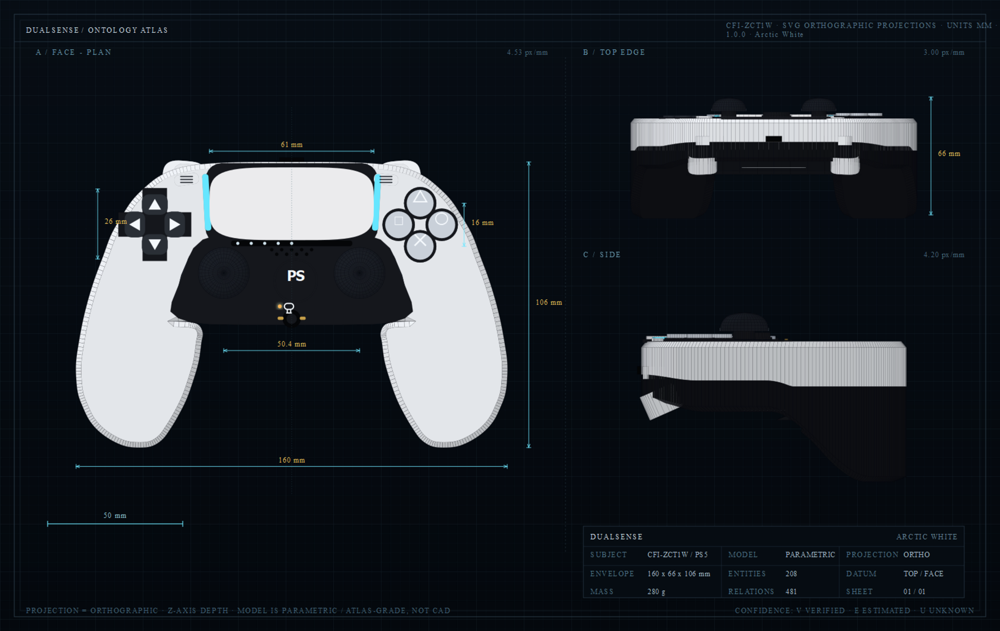
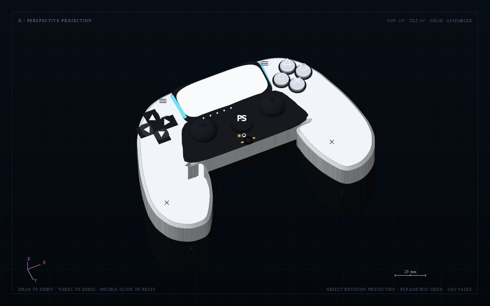
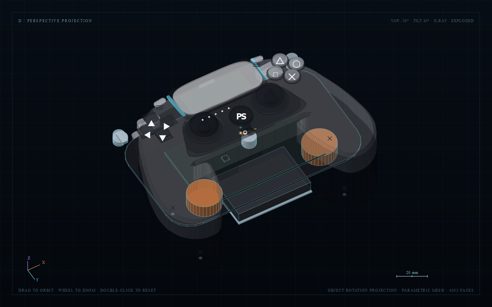

# DualSense — Ontology Atlas

A research-grounded, machine-readable **ontology** of the Sony PlayStation 5 **DualSense**
wireless controller (CFI-ZCT1W), rendered entirely as **SVG projections** in the browser.
No WebGL, no 3D assets, no network calls, no build step, no dependencies.



The atlas has four linked views of the same 208-entity graph:

| View | What it is |
| --- | --- |
| **Sheet** | Three orthographic SVG projections generated from one parametric mesh: face/plan, top edge, side. Dimension lines, title block, scale bars. |
| **Orbit** | The same mesh as an object-rotation projection rendered into SVG; drag to orbit, wheel to zoom, x-ray, exploded slider, face/iso/rear presets. |
| **Graph** | A radial ego-graph of the selected ontology node and its predicates. |
| **Matrix** | Every physical entity compared by class, material, geometry, face count and evidence confidence. |



## Open it

Double-click **`index.html`** — it runs from `file://`. The data and geometry are classic
scripts, not ES modules, so no server is required. It uses only standard HTML, CSS, inline
SVG and classic JavaScript, and has no runtime dependencies or network calls.

```text
dualsense-atlas/
  index.html          app shell
  styles.css          interface + SVG typography
  data/
    ontology.js       schema, classes, 50 predicates, 14 sources
    parts.js          product, systems, assemblies, physical parts
    domain.js         controls, features, geometry, materials, dimensions, standards
    ontology.json     machine-readable export (208 entities)
  js/
    geometry.js       ontology -> parametric mesh (mm)
    scene.js          mesh -> orthographic SVG / object-orbit SVG
    app.js            explorer, inspector, graph, matrix, interaction
  RESEARCH.md         ontology-grade research brief with per-figure confidence
  validate.mjs        consistency check (ids, sources, classes, predicates)
  export-json.mjs     regenerates data/ontology.json
  refs/               calibration/reference photographs (CC BY-SA, see refs/ATTRIBUTION.md)
  screenshots/        rendered projections
```

```bash
node validate.mjs      # OK 208 entities / 481 relations / 396 assertions / 14 sources
node export-json.mjs   # writes data/ontology.json
```

## Controls

| Input | Action |
| --- | --- |
| Click a part / node / row | Select it; the drawing dims, the inspector and the tree follow |
| Hover | Tooltip with entity class and confidence |
| Drag (Orbit) | Rotate the object |
| Wheel / pinch (Orbit) | Zoom |
| Double-click (Orbit) | Reset view |
| 1–4 | Sheet / Orbit / Graph / Matrix |
| D · X · L · R · Esc | Dimensions · x-ray · light bar · reset orbit · clear selection |

The toolbar carries the colourway swatches, x-ray, exploded slider, light-bar and
auto-rotate switches, plus the face/iso/rear orbit presets.

## What the ontology contains

**208 entities**, **481 explicit relations**, **396 assertions**, **14 sources**,
**22 classes**, **50 predicates**, **4,033 mesh faces**.

Layers: product, system, assembly, part, control, feature, sensor, actuator, interface,
geometry, curve, material, finish, colour, dimension, state, interaction, process, standard.
Every entity carries an id, label, class, layer, summary, parent, attributes, links and
(where physical) procedural geometry descriptors.

### Entity shape

```js
{
  id: "part.touchpad",
  label: "Touchpad",
  cls: "cls.part",
  layer: "part",
  parent: "asm.outer-shell",
  summary: "2-point capacitive touch surface with mechanical click ...",
  props: [
    { k: "Active width", v: 61, u: "mm", c: "E", s: "S12", note: "photogrammetric" },
    // c = V verified | E estimated | U unknown; s = source id
  ],
  links: [
    { p: "hasMaterial", o: "mat.touchpad" },
    { p: "realizes", o: "feat.touchpad" },
    { p: "controls", o: "ctl.touchpad" }
  ],
  geom: [ /* plate at (0,15.5), z=2.15, 61 x 27 mm, superellipse n=4.2 */ ]
}
```

Confidence is first-class:

* **V** — stated by Sony, a regulator or a teardown.
* **E** — photogrammetric/engineering estimate, with the method in `RESEARCH.md`.
* **U** — explicitly unknown. The atlas does not silently fill gaps (adaptive-trigger force,
  actuator specs, chip identities, antenna type, etc. are marked U).

### Grounding

The coordinate system is millimetres: **x** lateral (+ right), **y** down from the top edge,
**z** out of the face. The published envelope is **160 × 66 × 106 mm**; the sheet uses
160 wide × 106 face-on high × 66 thick. The face layout is photo-calibrated to the published
160 mm width:

| Feature | Value | Confidence |
| --- | --- | --- |
| Overall | 160 × 106 × 66 mm, 280 g | V |
| Touchpad | 61 × 27 mm, 2-point, clickable | E-PH |
| Light-bar strips | 2 × 22 × 2.5 mm, flanking the pad | E-PH |
| Sticks | Ø19 mm caps, centres ±25.2 mm, 41.2 mm below top | E-PH |
| Face buttons | Ø10 mm on 16 mm pitch, diamond at (+47.7, 23.3) | E-PH |
| D-pad | 26 × 26 mm at (−50.8, 23.2) | E-PH |
| PS / Mute | Ø15 mm at (+1.5, 44.1) / 8.3 × 2.5 mm at (−1, 53.6) | E-PH |
| Speaker | 5 + 4 holes, Ø1.3 mm, 16 × 3.6 mm | E-PH |
| Triggers | 10–12 mm travel / 25–35°, per-trigger motor + gear train | E / V |
| Battery | LIP1708, 1560 mAh, 3.65 V (≈5.7 Wh) | V |
| Radio | Bluetooth 5.1, 2402–2480 MHz; FCC ID AK8CFIZCT1 | V |

Full method, axis resolution, verified/estimated tables, unknowns and source URLs:
[**RESEARCH.md**](RESEARCH.md).

### Geometry pipeline

`data/ontology.js` + `parts.js` + `domain.js`
→ `js/geometry.js` builds a millimetre mesh from descriptors
(`shell`, `plate`, `lathe`, `petal`, `trigger`, `bar`, `grille`, `ring`, `box`, …)
→ `js/scene.js` projects it with explicit orthographic bases (face, top edge, side) or an
object-rotation transform (orbit), sorts faces, shades by normal, and emits SVG paths.
The face silhouette is a mirrored Catmull–Rom half-outline traced from a calibrated
160 mm front photograph; the shell is lofted through rounded rims with a depth profile
that thickens toward the grips.

The SVG markup is data-attributed (`data-part`, `data-node`) so clicking the drawing is
also a graph query. The inspector resolves the same entity's attributes, relations,
geometry and evidence.



### What is modelled

Shell and two-tone core; touchpad with bezel, flex and click; light guides; player LEDs;
speaker grille; dual mics; d-pad (4 keys); face buttons; Create/Options/PS/Mute; adaptive
triggers and bumpers; trigger motors, gear train, stopper, spring and position sensor;
voice-coil actuators; LIP1708 battery and bracket; USB-C; 3.5 mm jack; charging contacts;
main PCB, radio, antenna and 6-axis IMU; screws, reset pinhole and rear label. Internal
parts are available in **x-ray**; the exploded slider separates the face stack.

## Limits, deliberately stated

* This is an **atlas-grade approximation**, not a manufacturable CAD model. Photo-derived
  values carry about ±4% systematic error; unknown values are marked U.
* The shell thickness and grip depth profile are stylised within the published envelope.
  There is no public Sony dimensioned drawing or BOM.
* Trigger force, actuator dimensions, antenna type and silicon identities are not public.
* The sheet is a projection study, so the rear shell is shown only in the orbit/x-ray views.
* The preview PNGs in `screenshots/` are rasterised directly from the generated SVG (the drawing,
  not the surrounding app UI). The app itself is validated structurally; this environment had
  no GUI browser automation.
* Colourway hex values are approximate.

## Credits and licensing

Research and source list: see **RESEARCH.md** (Sony product/support pages, FCC ID database,
iFixit guides, Engadget, Wikipedia, Wikimedia Commons).

The two reference photographs in `refs/` are CC BY-SA 4.0 from Wikimedia Commons and are
used only for calibration/tracing; attribution is in [refs/ATTRIBUTION.md](refs/ATTRIBUTION.md).
The generated geometry, data and code in this folder are an independent, non-commercial
study. PlayStation, DualSense and the PlayStation logo are trademarks of Sony Interactive
Entertainment. This project is not affiliated with Sony.
