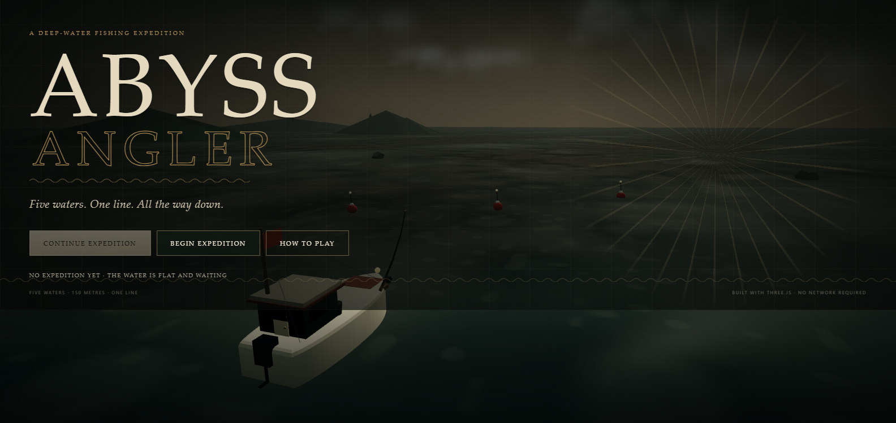
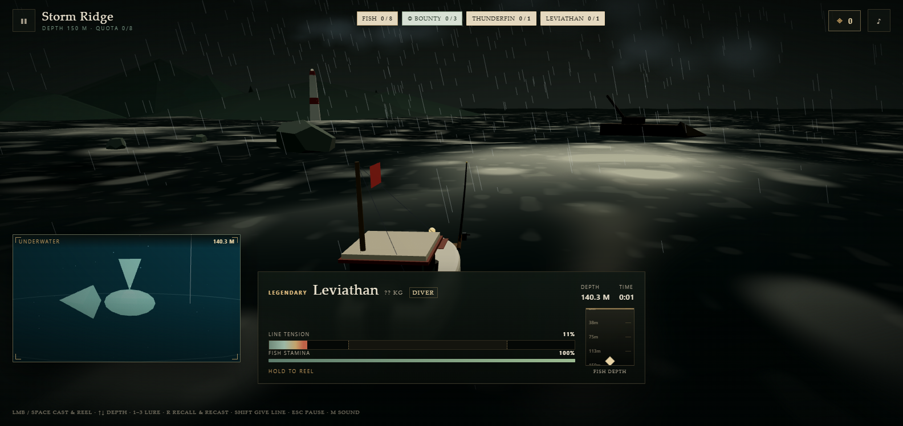
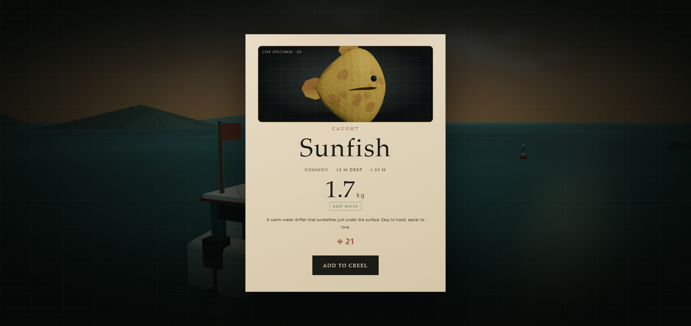
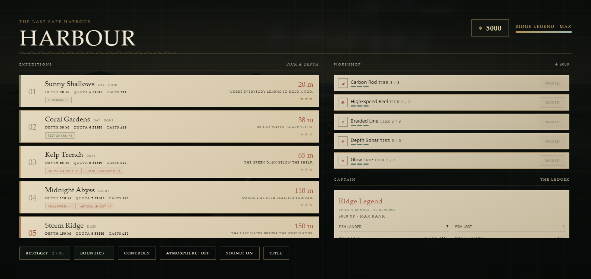
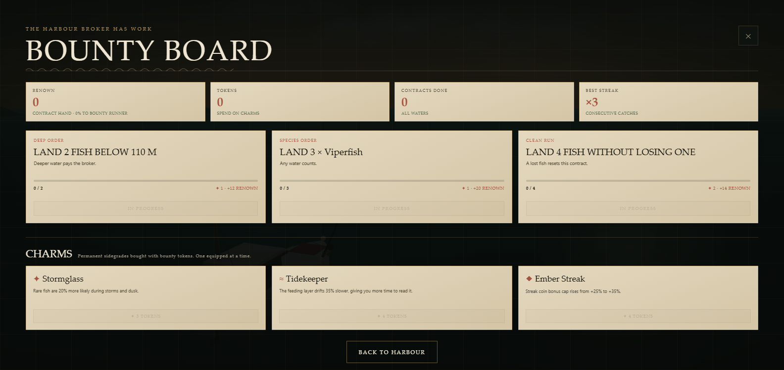

# ABYSS ANGLER

A 3D deep-water fishing game with five hand-built waters, a full fight system, a bestiary, a
workshop and a real sense of depth. Everything is local: no build step, no install, no network
requests. Double-click **index.html** and fish.

Fighting an Abyssal Ghost 103 m down, with the depth sonar reading the water column:

The catch card now shows the actual landed fish as a live 3D specimen:

    fishing game/
      index.html          open this
      css/style.css       HUD and menu styling
      js/data.js          35 fish, 5 levels, upgrades, ranks, tips
      js/world.js         Three.js ocean, sky, boat, rod, line, effects, underwater camera
      js/fishfactory.js   detailed procedural fish models (7 silhouettes, eyes, gills, fins)
      js/catchlab.js      live 3D specimen showcase on the catch card
      js/audio.js         procedural WebAudio effects + optional soft surf atmosphere
      js/game.js          casting, bites, fights, economy, save, UI
      vendor/three.min.js Three.js r128 (vendored so the game works offline)
      docs/DESIGN.md      design notes and module contracts
      docs/RESEARCH.md    fishing-game mechanics review and what was borrowed

## How to play

Hold the action to charge a cast, release to throw. Land near the school for double bites.
Set the lure depth, wait for the bite, strike, then reel the fish up while keeping the line out
of the red. Fish fight harder the deeper the water.

    CAST        hold LMB / Space (or hold the CAST button), release to throw
    DEPTH       Arrow Up / Down, mouse wheel, or the depth slider
    LURE        1 / 2 / 3 (minnow / jig / glow)
    RECALL      R, or the RECALL button while waiting — reel in and recast
    STRIKE      click / Space the instant the bobber goes under
    REEL        hold LMB / Space (or the REEL button)
    JIG         click / Space while waiting to stir the lure (watch the cooldown)
    GIVE LINE   hold Shift (or the GIVE LINE button) when a fish surges
    PAUSE       Esc
    SOUND       M
    ATMOSPHERE  optional soft surf bed, toggled in the harbour or pause menu (off by default)

A fish that runs is not a fish that wins: let go of the reel when the tension hits the red.
Line tension in the pale band tires the fish fastest. The fish is landed when it reaches the
surface. If the line stays over its limit for about a second, it snaps.

Every cast has a **feeding layer**: a moving depth band shown on the left of the depth panel
(and in the sonar once fitted). Keeping the lure inside it raises bite speed. **Jig** the lure
while the bobber sits to stir a bite, but jigging during the cooldown spooks the school.
Consecutive catches build a **streak** worth up to +25% coins; a missed strike or a lost fish
resets it.

The **lure box** is a real choice. The minnow is neutral; the jig sinks fast and bites hardest
inside the feeding layer but weakly outside it; the glow plug sinks slowly and trades bite rate
for rarer, heavier fish, especially at dusk and night. The **depth scan** under the lure row
reports what is actually in the selected band (names at sonar tier 2). **R** recalls the lure so
you can try another depth or position without waiting for a bite.

## The five waters

| # | Water | Depth | Quota | Targets | 2-star cast limit |
|---|-------|-------|-------|---------|-------------------|
| 1 | Sunny Shallows | 20 m | 5 fish | 1 Silverfin | 14 |
| 2 | Coral Gardens | 38 m | 6 fish | 1 Reef Shark | 18 |
| 3 | Kelp Trench | 65 m | 6 fish | 1 Ghost Halibut + 1 Trench Grouper | 22 |
| 4 | Midnight Abyss | 110 m | 7 fish | 1 Anglerfish + 1 Abyssal Ghost | 26 |
| 5 | Storm Ridge | 150 m | 8 fish | 1 Thunderfin + 1 Leviathan | 30 |

Three stars: complete the quota, finish inside the cast limit, and lose no fish. Every level can
be replayed for coins, best weights and bestiary completion. The five waters each have their own
sky, light, weather, scenery and fish: sunset shallows, a coral reef, misty kelp and a wreck,
a star-lit abyss, and a storm-lit ridge with rain and lightning.

## Fish and the catch showcase

Every fish is built at runtime from a shared low-poly rig, then given a species body profile,
procedural scale-and-pattern texture, layered eyes, gill slits, a lateral line, fin membranes
with rays, teeth or barbels where they fit, and a muted naturalist palette. A subtle vertex
wave runs down the body, so the fish flexes as it swims instead of moving like a rigid prop;
bright neon glow is reserved for genuinely deep bioluminescent species. The catch card renders
the actual caught model in a small separate WebGL surface — a live 3D specimen rotating under
a warm survey grid, scaled from the fish's real length.

## Depth is the game

- Each fish lives in a depth band. The sonar panel and the depth chips under the slider show
  where they are (tier 1 sonar reveals the bands, tier 2 names the species).
- The school sits at a random distance: the marker on the cast power bar shows the throw you need.
- The underwater picture-in-picture follows the hooked fish up through the water column while
  you fight it, with depth rings, bubbles, marine snow and light shafts.
- Deep fish start further down and fight longer, but pay far more.

## Visual style

The whole game is a **deepwater survey ledger**, not just the menus. The world is a cold North
Atlantic: pewter overcast sky, long swell, wind-driven foam lanes and a weathered ivory boat.
The water shader layers four directional swells with a fine chop normal and procedural foam;
the sky shader paints drifting overcast cloud bands. Gone are the turquoise tropical water and
sunset palette. The interface is ink-green charts, brass rules, aged-paper cards, serif
instrument labels, a compass rose on the title plate and engraved wave borders. Fish keep the
muted naturalist palette and swim with a subtle body wave; the catch card is a paper specimen
page with a dark survey inset.

## Progression

Coins buy five workshop lines (rod, reel, line, sonar, lure), each with three tiers. XP raises
your rank from Deckhand to Ridge Legend. The bestiary tracks 35 species, catch counts and best
weights. Fish also have fight **behaviours** — steady, runner, thrasher, diver, deadweight —
so two fish of similar weight can feel completely different on the line.

## Endgame: bounty board, renown and charms

After the campaign, the harbour broker keeps the water interesting with a rotating **bounty
board**. Three contracts are active at once — species orders, weight hunts, deep-water orders,
clean runs and simple catch orders. Progress carries across every water and is shown in the HUD
as a small bounty chip. Claim completed contracts for **tokens** and **renown**.

Renown raises a separate endgame title from **Contract Hand** to **Ridge Broker** in the captain
card. Tokens buy permanent sidegrade **charms** (one equipped at a time):

- **Stormglass** — rare fish are 20% more likely in storms and dusk.
- **Tidekeeper** — the feeding layer drifts 35% slower.
- **Ember Streak** — the coin-streak cap rises from +25% to +35%.

The board also tracks contracts completed and your best-ever catch streak.

## Save, backup and future releases

Progress autosaves in this browser (on catches, casts, losses and every few seconds) under
`abyss_angler_save_v6`, with a mirror slot
`abyss_angler_save_v6_backup` used automatically if the main slot is unreadable. The save schema
is versioned (currently v6) and merges new fields, so future fish, levels, upgrades and settings
can be added without losing an existing expedition. Older v5, v4, v3, v2 and v1 slots are read
once and migrated into v6 on load; the old keys are left untouched, so a previous game tab
cannot overwrite newer progress.

An interrupted run is checkpointed too: after a reload, **CONTINUE EXPEDITION → RESUME RUN**
restores the level, quota, creel, casts, streak and lure depth. The harbour footer shows the
resume button whenever a run is pending.

In the harbour, **SAVE DATA → EXPORT SAVE** downloads a JSON save file; **IMPORT SAVE** restores
one. That is the carry-forward path across browsers and future game/model releases. Imports are
validated and old v1/v2 saves are migrated on load. Your ambience/mute settings are stored in
the same save.

If a browser save is lost, the one-time URL `index.html?grant=max` restores a playable progress
floor: every upgrade at max, every water unlocked, Ridge Legend rank, 5,000 coins, and the save
moved to v6. It preserves any bestiary/completion data it can still find and never touches the
old v1/v2/v3/v4/v5 slots.

## Notes

- Works from file:// in current Chrome, Edge and Firefox. Three.js and all assets are local;
  no CDN and no runtime network access.
- Procedural everything: fish models, ocean shader, weather, tonal WebAudio effects.
- The optional atmosphere layer is filtered surf only — no sustained pads or low drones, so it
  cannot hum or buzz. It is off by default; enable it from the harbour or pause menu.
- The one-time `?grant=max` recovery path is described above.
- Endgame contracts, renown and charms are detailed under **Endgame: bounty board, renown and charms**.
- Debug helpers are available only when the page is opened with `?debug=1` (useful for QA:
  `Game.debug.unlockAll()`, `Game.debug.hook('leviathan')`, `Game.debug.land()`).
- Content is data-driven (`js/data.js`): new levels, fish and upgrades can be added by extending
  the arrays. Versioned saves merge new defaults, so existing progress remains valid.
- Designed on 16:9 and playable in portrait on a phone; touch gets dedicated CAST / REEL /
  GIVE LINE buttons.

## Verified

- Loads from file:// with no build step and no runtime network requests.
- Headless Chrome passes on desktop 1600x900 and mobile 390x844: cast, bite, strike, reel,
  give-line, catch, level completion, stars, unlock, shop to MAXED, bestiary, pause, final
  screen, save/reload. Zero console errors or exceptions.
- An independent review (src-plus-playtest) found no Critical or Major issues; its report is
  [docs/QA-REPORT.md](docs/QA-REPORT.md), including the follow-up fixes made after it.

