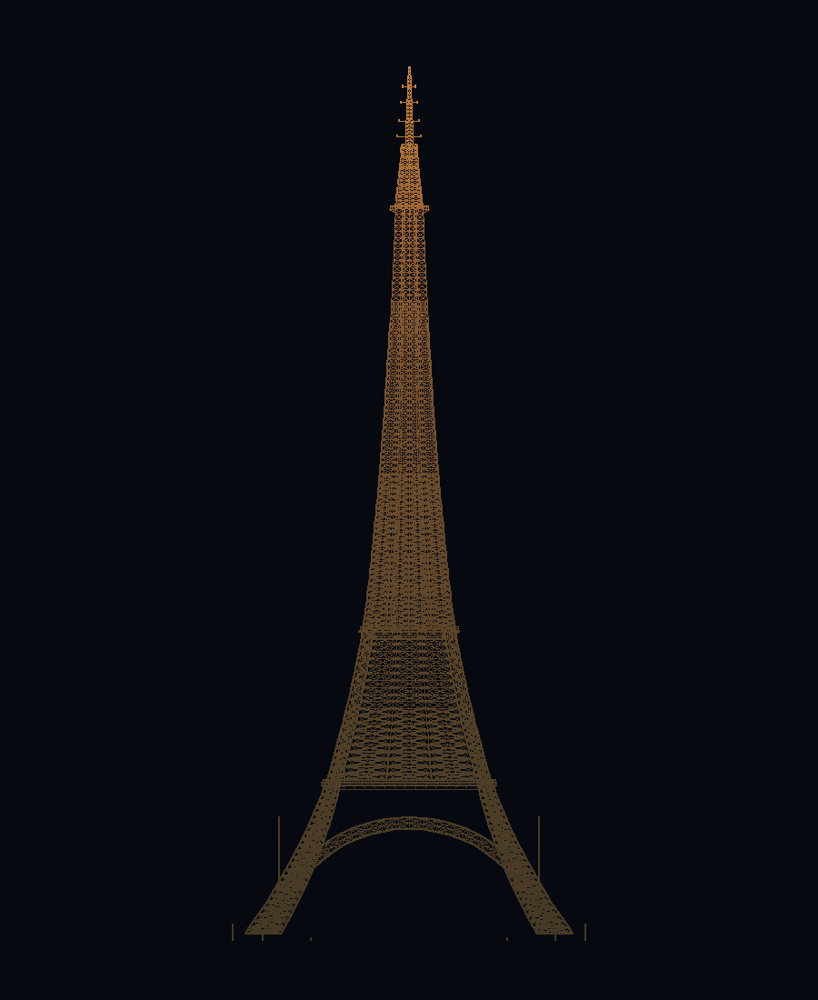

# La Tour Eiffel — procedural, dimensionally accurate 3D (three.js)

An interactive 1:1 model of the Eiffel Tower, generated entirely in JavaScript
from the monument's real dimensions. 1 unit = 1 metre, no imported meshes: every
member is computed and placed by code (≈ 27,600 lattice members in five
instanced draw calls), then rotated 45° so the four pillars stand at the four
points of the compass and the faces look towards the parts of Paris they really
face (SE École Militaire, NE La Bourdonnais, NW Trocadéro, SW Grenelle).



## Run it

ES modules + an import map need a real HTTP origin (`file://` is blocked by the
browser), so serve the folder — a tiny zero-dependency server is included:

```bash
cd eiffel-tower
node tools/serve.mjs 8123          # or: npx http-server . -p 8123 -c-1
# open http://127.0.0.1:8123
```

three.js r169 is **vendored in `vendor/three`**, so the page needs no network at
all. If you would rather pull it from a CDN, swap the two lines in the import
map in `index.html` (the CDN URLs are commented right above them).

### Deep links

Any view can be linked, which is also how the screenshots in `preview/` were
taken:

```
?sky=day|golden|blue|night|sparkle   &view=overview|esplanade|arches|first|
second|summit|aerial|trocadero|champ
&shadows=0 &bloom=0 &filigree=0 &lifts=0 &glass=0 &spin=1 &wire=1
&dpr=1 &frames=2
```

`frames=N` stops the render loop after N frames — handy for automated captures.

## What is modelled

**Dimensions (real, documented values — see `src/config.js`)**

| | |
|---|---|
| 1st floor | 57.63 m (deck 66.4 m square, 4,415 m²) |
| 2nd floor | 115.73 m (deck 37.8 m square, 1,430 m²) |
| Summit platform | 276.13 m (≈250 m²) |
| Roof of the campanile | 300.65 m |
| Antenna tip | 330.00 m (2022 mast) |
| Base square | 124.9 m (pillar diagonals 176.6 m) |
| Iron parts / rivets / puddled iron | 18,038 / 2,500,000 / 7,300 t |
| Steps to the 2nd floor / summit | 674 / 1,665 |

**Structure**

* the silhouette follows the exponential profile computed by Eiffel's engineers
  (monotone cubic through measured anchors, `src/profile.js`): strongly curved
  legs, a much straighter upper spire;
* four tapering lattice pillars (13.6 m box at the ground) with four main
  chords, horizontal frames, St Andrew's crosses and a fine diagonal web;
* the four decorative arches (springing ≈18 m, crown ≈42 m, band ≈4.4 m deep)
  with their lattice, springing blocks and keystone line;
* the braced faces between the 1st and 2nd floors, with a central girder that
  carries the 2nd floor deck;
* the upper shaft (115.73 → 276.13 m) with sixteen mullions, rings, crosses and
  an inner core carrying the two summit lifts;
* the masonry: four stone pedestals with steps and cast-iron "sabots";
* the two inclined lift tracks in every pillar with their double-deck cabins
  (1899) and the summit car — all animated;
* the spiral staircases (674 steps each, 0.1717 m rise, the real figure);
* three decks with railings, knee braces, radial floor beams and glass floors;
* the **frieze of the 72 engraved names** under the first balcony, in 60 cm
  gold letters, painted on canvas per face and set in the correct order for
  each side of the tower (`src/frieze.js`);
* the summit: platform, glassed top room, Gustave Eiffel's apartment, the
  campanile and the antenna mast with its dipole tiers and microwave dishes;
* 20,000 sparkle bulbs **sampled on the real members of the model**, with a
  twinkle shader, plus the rotating beacon and the red aircraft light at 330 m;
* the site: esplanade, Champ de Mars lawns and paths, the Seine with the Pont
  d'Iéna, the Palais de Chaillot and 70 trees — all 1:1 with the tower.

**Lighting / look**

Five presets (Golden hour, Midday, Blue hour, Night, Sparkle). The ironwork is
painted in three shades of "Eiffel Tower brown", darkest at the base and
lightest at the top, exactly as the monument is repainted; the colour is
applied per instance as an instance attribute. Painted iron is a dielectric, so
the material keeps a low metalness (0.16) — a metallic setting would drop the
diffuse term and turn the tower into a black silhouette. Night adds the
336-projector lighting (approximated by six spotlights), an emissive lift, the
20,000-bulb illumination and UnrealBloom post-processing, while the environment
intensity drops to 0.07 so the city really goes dark. An environment map
(`RoomEnvironment`) gives the metal its sheen.

## Controls

* drag = orbit, wheel = zoom, right-drag = pan
* **Light**: the five sky presets
* **Viewpoint**: Overview, Esplanade, Arches, 1st floor, 2nd floor, Summit,
  Aerial, Trocadéro, Champ de Mars (animated camera flights; keys `o e a 1 2 s`
  also work)
* **Model**: filigree (22,000 fine bars), shadows, lifts, auto-orbit, glass
  floors, wireframe
* readout at the bottom: camera altitude above the ground, range, member count

## Verify it yourself

```bash
npm install                # only three, for the headless geometry tools
node tools/validate.mjs    # profile, heights, instance data, bbox, lifts, bulbs, presets
node tools/preview.mjs     # software-renders preview/*.png from the model data
node tools/shot.mjs "http://127.0.0.1:8123/?sky=night&frames=2" preview/night.png
```

* `tools/preview.mjs` is a small PNG writer + line rasteriser: it projects every
  instanced member, so the silhouette can be checked without a GPU. It produced
  `preview/front.png`, `three-quarter.png`, `base.png` and `summit.png`.
* `tools/shot.mjs` drives a real Chrome through `puppeteer-core`
  (`npm i -D puppeteer-core`), prints console/page errors, waits for
  `window.__APP_READY` and saves a screenshot. It produced the `preview/shot-*.png`
  images above — those are the actual WebGL render, on the ANGLE/SwiftShader
  software driver.

## Layout

```
index.html          import map, HUD, loader, error overlay
vendor/three/       three.js r169 + the six addons used (offline)
src/config.js       real dimensions, paint shades, sky presets
src/profile.js      the exponential silhouette (PCHIP) + member thicknesses
src/frame.js        pillar/face/perimeter frame of the tower
src/beam.js         instanced beam builder + panel lattice helper
src/legs.js         pillars, inner cores, stairs, lift tracks
src/arcs.js         the four decorative arches
src/mid.js          braced faces between the 1st and 2nd floors
src/shaft.js        the upper shaft and its core
src/platforms.js    decks, railings, glass floors, pavilions, frieze band
src/base.js         pedestals, sabots, steps, ground pavilions
src/summit.js       summit platform, campanile, antenna mast
src/frieze.js       the 72 names + canvas textures
src/tower.js        assembly, materials, moving lifts
src/world.js        sky shader, ground, Seine, trees, lights, presets
src/sparkle.js      20,000 bulbs + rotating beacon
src/main.js         renderer, composer, camera flights, UI
tools/serve.mjs     static server
tools/validate.mjs  headless geometry checks
tools/preview.mjs   software wireframe renderer (PNG)
tools/shot.mjs      Chrome + puppeteer-core screenshot tool
```

## Sources

Official key figures and the 1889 construction records
([toureiffel.paris](https://www.toureiffel.paris/en/the-monument/key-figures)),
the tower's Wikipedia article for the platform areas, heights and materials,
and the [list of the 72 names](https://en.wikipedia.org/wiki/List_of_names_on_the_Eiffel_Tower)
for the frieze. The profile anchors come from Eiffel's published drawings; the
taper constant per section is fitted to them (`src/profile.js`).
