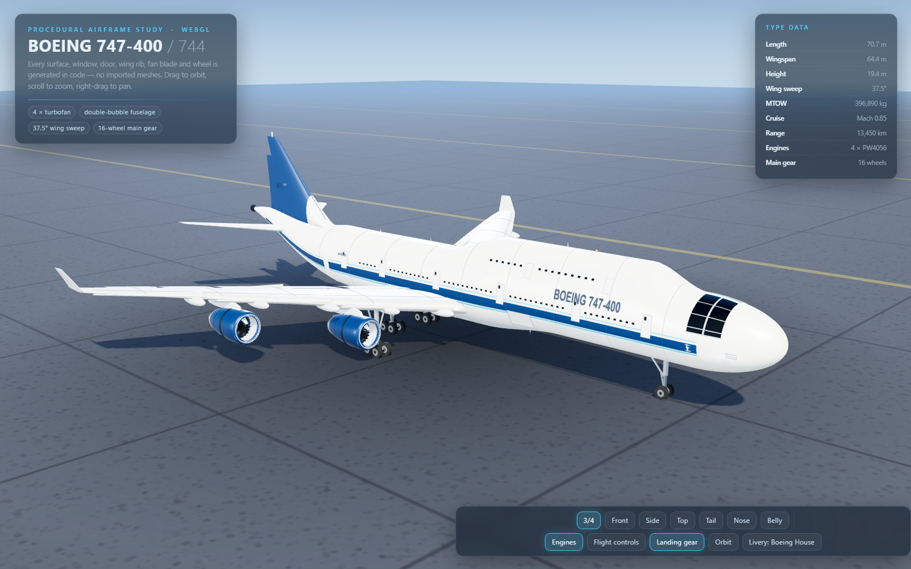

# BOEING 747-400 — ultradetailed procedural 3D model

A self-contained WebGL showcase. **Every surface is generated from code** in
`js/aircraft.js` — there are no imported meshes and no bitmap textures on the
airframe (decals and the tarmac are drawn to canvas at runtime).

## Run

Double-click **`index.html`** — it works straight from `file://` with no server
(three.js r147 and OrbitControls are vendored in `lib/`, so it also works offline).
If you prefer a server:

    npx serve .        # or: python -m http.server

## Controls

| input | action |
| --- | --- |
| drag / scroll / right-drag | orbit / zoom / pan |
| 3⁄4 · Front · Side · Top · Tail · Nose · Belly | animated camera presets |
| **Engines** | spool the four fan assemblies up / down |
| **Flight controls** | animate ailerons, flaps, elevators and rudder |
| **Landing gear** | show / hide the landing gear |
| **Orbit** | slow turntable |
| **Livery** | Boeing House · Retro Red · Jade |
| double-click | return to the hero view |

URL parameters: `?view=side&rotate=0&gear=0&engines=0&demo=1&livery=jade`.

## What the model contains

* **Fuselage** — 176 lofts of a double-bubble cross-section: elliptical radome,
  the 747 upper-deck hump with its own fairing, tapered tail cone with upsweep,
  wing/body belly fairing, belly colouring baked into vertex colours.
* **Cockpit** — wrap-around glazing mapped onto the curved nose, split by
  mullions and a sill, plus frame seams and pitot probes.
* **Cabin** — ~140 instanced main-deck windows, upper-deck window row, six main
  doors + two upper-deck doors per side (dark seal + panel + door window),
  cargo doors, curved `BOEING 747-400` titles and the `N747HH` registration
  wrapped onto the skin.
* **Wing** — 17 NACA-style sections, 37.5° leading-edge sweep, 6.5° dihedral,
  washout-free cambered profile, canted winglets, three leading-edge slats per
  side, inboard/outboard flaps, ailerons and five spoiler panels per wing,
  five flap-track fairings, panel seam lines, nav/strobe lights.
* **Engines** — four lathed nacelles with rounded inlet lips, grey inlet ducts,
  rotating 24-blade fan + spinner, fan disc, core cowl, nozzle, exhaust plug,
  reverser band, seams and extruded pylons matched to the local wing section.
* **Empennage** — swept fin with dorsal fillet, rudder on its hinge line,
  stabilisers with elevators, fin cap, `747` tail number on both sides.
* **Landing gear** — nose gear (2 wheels, drag brace, torque links) plus four
  main legs with 4-wheel bogies: **18 wheels total**, each with tyre, hub and
  axle detail.
* **Animation** — fan spool-up, flight-control demo, blinking strobes, pulsing
  beacons, smooth camera transitions, orbit turntable.
* **Scene** — procedural sky, PMREM image-based lighting from a generated
  equirect environment, sun shadows (2048² PCF soft), tarmac with canvas
  texture, contact-shadow patch, ACES tone mapping.

## Files

    index.html        page shell, HUD, view/feature buttons
    js/aircraft.js    all 747 geometry + animation (~1,100 lines, no data files)
    js/app.js         renderer, sky/IBL, tarmac, lights, camera presets, UI wiring
    lib/three.min.js  Three.js r147 (vendored)
    lib/OrbitControls.js
    preview.png       render of the default hero view
