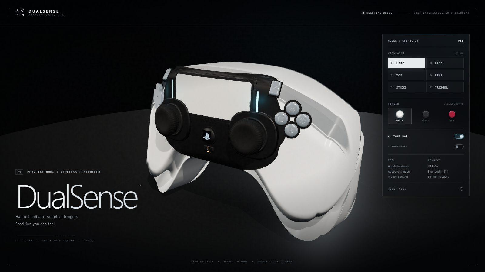

# DualSense — Interactive 3D Study

A fully procedural, high-detail recreation of the PlayStation 5 DualSense wireless
controller, built with **Three.js r170**, HTML and JavaScript. There are no external
3D assets, texture files or network calls at runtime — the shell, controls,
textures, studio environment and interface are all generated in the browser.

## Run it

The page uses ES modules, so it needs to be served over HTTP (opening index.html
directly from disk will be blocked by the browser's module security rules).

Double-click **Open DualSense.bat**, or from this folder:

~~~bash
node serve.mjs
~~~

Then open **http://127.0.0.1:8153/**. Requires a WebGL 2-capable browser
(Chrome, Edge, Firefox or Safari — tested on Edge/Chromium with an AMD GPU).

## Controls

| Input | Action |
| --- | --- |
| Drag | Orbit |
| Scroll / pinch | Zoom |
| Double-click | Reset to hero view |
| 1 – 6 | Hero / Face / Top / Rear / Sticks / Trigger views |
| L | Toggle light bar |
| T | Toggle turntable |
| R | Reset camera |

The right-hand panel also switches viewpoint, finish, light bar and turntable.
Three finishes are included: **Arctic White**, **Midnight Black** and **Cosmic Red**.

## What is modelled

- **Shell** — a custom lofted, rounded-rectangle cross-section that tapers into the
  wings, grips and arched underside; 16 × 10.6 × 6.6 cm body proportions based on
  the official 160 × 106 × 66 mm dimensions.
- **Two-tone construction** — satin white outer shell, separate curved black core
  plate with gasket, raised touchpad bezel and black lower centre section.
- **Touchpad** — correctly proportioned curved white pad with black surround,
  recessed gasket, rounded corners and a subtle plastic micro-texture.
- **Dual analog sticks** — recessed oval shrouds, stepped collars, metal shaft rings,
  lathed rubber caps with a dished thumb surface and moulded knurled rims.
- **D-pad** — four separate smoke-acrylic keys with engraved arrows, set into a
  cross-shaped black recess.
- **Face buttons** — clear smoke keys for triangle / circle / cross / square with
  individually generated symbols and black button seats.
- **System controls** — Create and Options pills, PS button with the PlayStation
  mark, mute button with orange LED, and nine recessed speaker perforations.
- **Light bar** — emissive cyan diffusers flanking the touchpad, additive glow
  sprites, point lights and a slow breathing pulse (toggleable).
- **Shoulder hardware** — bumpers and tapered adaptive-trigger paddles at the rear,
  revealed when the camera moves behind the controller.
- **Rear details** — recessed specification label panel with barcode/regulatory
  print, screws and reset pinhole.
- **Bottom edge** — USB-C port with trim, 3.5 mm headphone jack and black port band.
- **Materials** — MeshPhysicalMaterial white plastic with procedural colour,
  roughness and bump maps; satin black core; rubber; chrome; smoked acrylic;
  emissive light bar. ACES filmic tone mapping, soft shadow maps and a custom
  PMREM studio environment with large softboxes.

## Technical notes

- src/deck.js defines the silhouette splines and the analytic curved surface used
  to place every control flush on the shell.
- src/controller.js builds the model from real-world centimetre dimensions.
- src/materials.js generates all textures on canvas (plastic grain, speckle,
  scratches, knurling, labels and button icons).
- src/environment.js builds a photo-studio environment and the floor/backdrop.
- src/main.js handles the camera, view transitions, colourways, UI and animation.
- The scene is roughly 470–500k triangles and ~150–170 draw calls.
- Intentionally desktop-first; a compact responsive layout is included, but the
  model is best viewed on a large display.

## Credit / disclaimer

This is an independent, non-commercial 3D study. PlayStation, DualSense and the
PlayStation logo are trademarks of Sony Interactive Entertainment. The model is a
procedural approximation made for demonstration and is not affiliated with Sony.

Three.js is © 2010–2024 Three.js Authors, distributed under the MIT licence
(see vendor/THREE-LICENSE.txt).