# Sagrada Família — independent QA report

**Verdict: PASS** — all executed checks passed (96/96); mobile section dropped and verified externally by the Lead; 1 known visual defect documented in curated review

| | |
|---|---|
| Run started | 2026-10-17T11:51:33.149Z |
| Run finished | 2026-10-17T12:01:11.920Z |
| App URL | http://127.0.0.1:8145/ |
| Browser | Edge (playwright-core 1.64.1) |
| GPU renderer | ANGLE (AMD, AMD Radeon RX 5700 XT (0x0000731F) Direct3D11 vs_5_0 ps_5_0, D3D11) /  |
| Viewports | interaction 800×500, capture 1280×720, hero 1600×900, mobile 390×844 |
| Static server | already running on port 8145 |
| Final fast pass | 2026-10-17T12:01:11.920Z — boot/groups/NaN + final-build captures (mobile section dropped, see coverage) |

## Summary

| Checks | Count |
|---|---|
| Passed | 96 |
| Failed | 0 |
| Skipped | 0 |
| Screenshots | 30 |

**Automated failures:** none.
**Curated visual defects:** `MAJOR` Residual teal-green roof slab visible from inside at the crossing vault springing; `INFO` Glory façade wall through the crossing (FIXED, verified); `INFO` Tour caption mid-transition capture (FIXED, verified).

## Pass / fail table

### boot

| # | Check | Result | Detail |
|---|---|---|---|
| 1 | app boots and signals window.__sagrada.ready | ✅ pass | ready in 8967 ms |
| 2 | real GPU renderer active (ANGLE D3D11, not SwiftShader) | ✅ pass | {"renderer":"ANGLE (AMD, AMD Radeon RX 5700 XT (0x0000731F) Direct3D11 vs_5_0 ps_5_0, D3D11)","vendor":"Google Inc. (AMD)","webgl2":true,"pixelRatio":1} |
| 3 | renderer canvas exists at viewport size | ✅ pass | {"w":800,"h":500,"cw":800,"ch":500} |
| 4 | loading screen is dismissed | ✅ pass | {"cls":"hidden","display":"flex","visibility":"visible","opacity":"0.0237509"} |
| 5 | no uncaught page errors during boot | ✅ pass | clean |
| 6 | all builders completed without recorded errors | ✅ pass | no builder errors |
| 7 | all five builder groups are present and non-empty | ✅ pass | {"environment":"34 meshes/14,802 tris","glory-shell":"22 meshes/232,270 tris","facades-np":"36 meshes/329,431 tris","towers":"55 meshes/108,142 tris","interior":"109 meshes/376,904 tris"} |
| 8 | no geometry contains NaN/Infinity vertex positions | ✅ pass | 257 meshes / 3,181,081 vertices clean |
| 9 | window.__sagrada debug API is complete | ✅ pass | complete |
| 10 | the rendered canvas is not black | ✅ pass | {"mean":119.2,"std":32.01,"min":12,"max":224,"darkFrac":0,"levels":12,"w":800,"h":500} |

### splash

| # | Check | Result | Detail |
|---|---|---|---|
| 11 | splash screen with title and three entry buttons is visible | ✅ pass | {"splash":true,"title":"La SagradaFamília","buttons":["walk","fly","tour"],"buttonsVisible":3,"btnRects":[[80,277,208,30],[296,277,208,30],[512,277,208,30]]} |
| 12 | clicking "Enter on foot" enters walk mode | ✅ pass | {"mode":"walk","splashHidden":true,"enabled":true,"entered":true} pos=72.0,1.7,100.0 |
| 13 | enter-on-foot lands at the authored plaza start pose | ✅ pass | pos=72.00,1.66,100.00 mode=walk |

### walk

| # | Check | Result | Detail |
|---|---|---|---|
| 14 | holding W moves the camera forward | ✅ pass | moved 8.28 m (vertical 0.00 m), 6 samples, fps≈60 |
| 15 | eye height and ground contact are sane | ✅ pass | camera y=1.66 feet y=-0.06 eye=1.72 dim=1.72 onGround=true |
| 16 | Space jumps | ✅ pass | y 1.66 → 2.43 → 1.66 |

### collision

| # | Check | Result | Detail |
|---|---|---|---|
| 17 | Nativity façade wall blocks the walker (no pass-through) | ✅ pass | start=(24.09,1.66,15.63) end=(28.63,1.67,15.64) max x=28.63 z-range 15.62..15.64 mode=walk (wall inner face ≈29.98, expected stop ≈29.56) |
| 18 | ground-standing apostle tower blocks the walker | ✅ pass | start x=17.50 end x=20.63 max x=20.63 (tower west face 21.2, expected stop ≈20.78) |
| 19 | crossing porphyry column blocks the walker | ✅ pass | start x=8.00 end x=10.68 max x=10.68 (column surface 11.85, expected stop ≈11.43) |

### doors

| # | Check | Result | Detail |
|---|---|---|---|
| 20 | Nativity façade door is passable (walk in from the east) | ✅ pass | start=(38.0,1.7,0.0) end=(13.76,1.71,0.00) moved 24.2 m; x=13.76 (must be < 27.5, wall plane x≈30.8); y sane=true |
| 21 | Passion façade door is passable (walk in from the west) | ✅ pass | start=(-38.0,1.7,0.0) end=(-13.69,1.71,-0.00) moved 24.3 m; x=-13.69 (must be > -27.5, wall plane x≈-30.8); y sane=true |
| 22 | Glory façade central door is passable (walk in from the south) | ✅ pass | start=(0.0,1.7,53.0) end=(-0.00,1.71,28.69) moved 24.3 m; z=28.69 (must be < 42.5, wall plane z≈45.8); y sane=true |
| 23 | walker can reach the crossing from the Glory entrance | ✅ pass | pos=(0.01,1.73,2.68) after 11 s walking south→north (4.6 m/s walk) |

### fly

| # | Check | Result | Detail |
|---|---|---|---|
| 24 | F toggles walk → fly | ✅ pass | mode=fly label=FLY |
| 25 | Space rises in fly mode | ✅ pass | fly mode=fly, y 20.00 → 33.31 while holding Space |
| 26 | Ctrl descends in fly mode | ✅ pass | y 40.00 → 27.91 while holding Ctrl |
| 27 | Q descends / E rises in fly mode (as documented) | ✅ pass | y 40.00 → Q (fall) 29.41 → E (rise) 39.58 |
| 28 | Shift boosts fly speed | ✅ pass | normal 7.63 m vs boosted 28.08 m in 0.6 s |

### teleport

| # | Check | Result | Detail |
|---|---|---|---|
| 29 | teleport() works for every TOUR stop (12 stops) | ✅ pass | 12 stops teleported correctly |

### tour

| # | Check | Result | Detail |
|---|---|---|---|
| 30 | T starts the guided tour with a caption | ✅ pass | {"mode":"tour","panelVisible":true,"title":"Plaça de Gaudí","body":"Gaudí imagined a cathedral as a forest: stone trunks, a canopy of leaves, light …","index":"01 / 12"} |
| 31 | tour advances between stops | ✅ pass | before={"index":"01 / 12","title":"Plaça de Gaudí"} after={"index":"02 / 12","title":"Nativity Façade"} |
| 32 | pause button toggles to Resume | ✅ pass | paused label="Resume" resumed label="Pause" |
| 33 | Escape exits the tour to free look | ✅ pass | {"mode":"fly","panelHidden":true,"enabled":true} |

### hotspots

| # | Check | Result | Detail |
|---|---|---|---|
| 34 | builder hotspots are registered | ✅ pass | 35 hotspots: plaza, city, nightfall, glory-facade, glory-portal, glory-virtues, glory-dove, glory-threshold, glass-cool, glass-warm, nave-shell, transept-glazing |
| 35 | aiming at a hotspot shows the reticle label | ✅ pass | active="city" title="Barcelona, around" hint="E to read" |
| 36 | E opens the info card with content | ✅ pass | {"visible":true,"title":"Barcelona, around","bodyLen":241} |
| 37 | Escape closes the info card and restores control | ✅ pass | {"hidden":true,"enabled":true} |

### time

| # | Check | Result | Detail |
|---|---|---|---|
| 38 | setTime(10.35) gives a morning scene | ✅ pass | {"time":10.350000000000001,"night":0,"clock":"10:21","period":"Morning","slider":10.25,"sun":1} |
| 39 | setTime(21.5) gives a night scene with floodlights | ✅ pass | {"time":21.5,"night":1,"clock":"21:30","period":"Night","slider":21.5,"sun":1} |
| 40 | N toggles between day and night | ✅ pass | time 21.5 → 10.350000000000001 |
| 41 | night scene renders lit content (not a black frame) | ✅ pass | {"mean":140.73,"std":57.7,"min":6,"max":207,"darkFrac":0,"levels":13,"w":800,"h":500} |

### ui

| # | Check | Result | Detail |
|---|---|---|---|
| 42 | M opens the plan/minimap and it is painted | ✅ pass | {"visible":true,"painted":true,"size":[322,206],"closed":true} |
| 43 | H opens/closes the help overlay and does not trap control | ✅ pass | open={"hidden":false,"enabled":false} closed={"hidden":true,"enabled":true} |
| 44 | P hides the interface and P restores it | ✅ pass | photo={"root":true,"hud":"none","controls":true} restored={"root":false,"hud":"block","controls":true} |
| 45 | hideUI(true/false) hides and restores every overlay | ✅ pass | hidden={"cls":true,"hudDisplay":"none"} restored={"cls":false,"hudDisplay":"block"} |
| 46 | quality low/high changes the renderer setting | ✅ pass | narrowLayout=true popOpen=true low={"quality":"low","pr":0.75} high={"quality":"high","pr":1} |
| 47 | sound control exists and toggles (audio content not asserted) | ✅ pass | narrowLayout=true controlVisible=true muted false → true → false (headless audio output is not asserted) |
| 48 | HUD fits the viewport without overflow | ✅ pass | {"scrollW":800,"innerW":800,"scrollH":500,"innerH":500,"controls":[576,12,788,105],"rootVisible":true,"hudDisplay":"block"} |
| 49 | responsive HUD layout at 800px | ✅ pass | {"narrow":true,"nav":false,"menu":true,"innerW":800} |
| 50 | clicking the view does not break the experience (pointer-lock fallback) | ✅ pass | locked=false toast="Sound on" moved=2.98 m |

### urlparams

| # | Check | Result | Detail |
|---|---|---|---|
| 51 | URL params skipSplash/mode/pos/look/time/ui are honoured | ✅ pass | {"mode":"walk","pos":[10,1.66,60],"time":21.5,"night":1,"allHidden":true,"hudHidden":true,"splashHidden":true,"poseSettled":true} |
| 52 | URL params mode=tour&tour=<id> start the tour at that stop | ✅ pass | {"mode":"tour","title":"The Nave","panel":true,"index":5} |
| 53 | URL param photo=1 starts in photo mode | ✅ pass | {"photo":true,"hud":"none","mode":"fly"} |

### capture

| # | Check | Result | Detail |
|---|---|---|---|
| 54 | screenshot 02-exterior-3q is a live render (not black/blank) | ✅ pass | {"mean":115.21,"std":33.05,"min":14,"max":203,"darkFrac":0,"levels":11,"w":1600,"h":900} |
| 55 | screenshot 03-facade-nativity is a live render (not black/blank) | ✅ pass | {"mean":93.02,"std":26.06,"min":9,"max":187,"darkFrac":0,"levels":9,"w":1280,"h":720} |
| 56 | screenshot 04-facade-passion is a live render (not black/blank) | ✅ pass | {"mean":115.97,"std":42.48,"min":11,"max":198,"darkFrac":0,"levels":12,"w":1280,"h":720} |
| 57 | screenshot 05-facade-glory is a live render (not black/blank) | ✅ pass | {"mean":115.38,"std":40.27,"min":15,"max":226,"darkFrac":0,"levels":13,"w":1280,"h":720} |
| 58 | screenshot 06-nave-interior is a live render (not black/blank) | ✅ pass | {"mean":142.48,"std":43.21,"min":20,"max":255,"darkFrac":0,"levels":14,"w":1600,"h":900} |
| 59 | screenshot 07-crossing is a live render (not black/blank) | ✅ pass | {"mean":120.5,"std":41.02,"min":14,"max":255,"darkFrac":0,"levels":15,"w":1600,"h":900} |
| 60 | screenshot 08-altar is a live render (not black/blank) | ✅ pass | {"mean":152.8,"std":44.5,"min":28,"max":253,"darkFrac":0,"levels":14,"w":1280,"h":720} |
| 61 | screenshot 09-apse is a live render (not black/blank) | ✅ pass | {"mean":165.83,"std":26.73,"min":59,"max":211,"darkFrac":0,"levels":10,"w":1280,"h":720} |
| 62 | screenshot 10-towers is a live render (not black/blank) | ✅ pass | {"mean":122.36,"std":33.39,"min":20,"max":206,"darkFrac":0,"levels":11,"w":1280,"h":720} |
| 63 | screenshot 11-aerial-plan is a live render (not black/blank) | ✅ pass | {"mean":108.19,"std":29.85,"min":14,"max":199,"darkFrac":0,"levels":9,"w":1280,"h":720} |
| 64 | screenshot 12-night-exterior is a live render (not black/blank) | ✅ pass | {"mean":21.5,"std":35.7,"min":0,"max":235,"darkFrac":0.503,"levels":13,"w":1600,"h":900} |
| 65 | screenshot 13-night-interior is a live render (not black/blank) | ✅ pass | {"mean":97.98,"std":49.84,"min":7,"max":255,"darkFrac":0,"levels":16,"w":1600,"h":900} |
| 66 | screenshot 14-tour-caption is a live render with caption visible | ✅ pass | {"title":"Nativity Façade","panel":true} {"mean":140.66,"std":38.49,"min":35,"max":204,"darkFrac":0,"levels":9,"w":1280,"h":720} |
| 67 | screenshot 15-hotspot-card shows the open info card | ✅ pass | title="Barcelona, around" {"mean":52.88,"std":22.09,"min":8,"max":179,"darkFrac":0,"levels":6,"w":1280,"h":720} |
| 68 | screenshot 16-minimap shows the plan panel | ✅ pass | {"visible":true} |
| 69 | screenshot 17-photo-mode is a clean render with no HUD | ✅ pass | {"photo":true,"hud":"none"} |
| 70 | tour stop plaza renders | ✅ pass | teleport=true 290 calls / 1,218,684 tris / 60 fps |
| 71 | tour stop nativity renders | ✅ pass | teleport=true 272 calls / 1,216,816 tris / 60 fps |
| 72 | tour stop nativity-portal renders | ✅ pass | teleport=true 241 calls / 1,167,751 tris / 60 fps |
| 73 | tour stop passion renders | ✅ pass | teleport=true 260 calls / 1,216,252 tris / 60 fps |
| 74 | tour stop glory renders | ✅ pass | teleport=true 279 calls / 1,218,652 tris / 60 fps |
| 75 | tour stop nave renders | ✅ pass | teleport=true 248 calls / 1,178,362 tris / 60 fps |
| 76 | tour stop crossing renders | ✅ pass | teleport=true 215 calls / 1,139,623 tris / 60 fps |
| 77 | tour stop altar renders | ✅ pass | teleport=true 155 calls / 749,733 tris / 60 fps |
| 78 | tour stop organ renders | ✅ pass | teleport=true 237 calls / 1,162,966 tris / 60 fps |
| 79 | tour stop towers renders | ✅ pass | teleport=true 135 calls / 766,481 tris / 60 fps |
| 80 | tour stop summit renders | ✅ pass | teleport=true 285 calls / 1,218,136 tris / 60 fps |
| 81 | tour stop night renders | ✅ pass | teleport=true 280 calls / 1,218,664 tris / 60 fps |

### perf

| # | Check | Result | Detail |
|---|---|---|---|
| 82 | frame rate is workable at capture resolution | ✅ pass | high-quality fps 60–60 across 15 sampled poses/stops (headless GPU via ANGLE/D3D11; compare relative numbers) |

### health

| # | Check | Result | Detail |
|---|---|---|---|
| 83 | no uncaught page errors across the whole run | ✅ pass | none |
| 84 | no unexpected console errors (favicon 404 excluded) | ✅ pass | none |
| 85 | no failed asset requests (favicon excluded) | ✅ pass | none |

### fastpass

| # | Check | Result | Detail |
|---|---|---|---|
| 86 | app boots and reaches ready | ✅ pass | ready in 9582 ms |
| 87 | real GPU renderer (ANGLE D3D11, not SwiftShader) | ✅ pass | ANGLE (AMD, AMD Radeon RX 5700 XT (0x0000731F) Direct3D11 vs_5_0 ps_5_0, D3D11) |
| 88 | all five builder groups present and non-empty | ✅ pass | {"environment":"34 meshes/14,802 tris","glory-shell":"22 meshes/232,270 tris","facades-np":"36 meshes/329,431 tris","towers":"55 meshes/108,142 tris","interior":"111 meshes/374,620 tris"} |
| 89 | no builder errors recorded | ✅ pass | none |
| 90 | no NaN/Infinity geometry positions | ✅ pass | 259 meshes / 3,174,229 vertices clean |
| 91 | capture 06-nave-interior is live (not black/blank) | ✅ pass | {"mean":142.59,"std":45.71,"max":255,"darkFrac":0,"levels":14,"w":1600,"h":900} |
| 92 | capture 07-crossing is live (not black/blank) | ✅ pass | {"mean":142.89,"std":45.52,"max":255,"darkFrac":0,"levels":14,"w":1600,"h":900} |
| 93 | capture 08-altar is live (not black/blank) | ✅ pass | {"mean":151.58,"std":44.19,"max":253,"darkFrac":0,"levels":14,"w":1280,"h":720} |
| 94 | render stats captured at nave + crossing | ✅ pass | nave 263 calls/1197680 tris/60 fps; crossing 205 calls/1163660 tris/60 fps |
| 95 | capture 14-tour-caption is live (not black/blank) | ✅ pass | {"mean":83.29,"std":29.65,"max":199,"darkFrac":0,"levels":10,"w":1280,"h":720} |
| 96 | capture 13-night-interior is live (not black/blank) | ✅ pass | {"mean":95.16,"std":49.26,"max":255,"darkFrac":0,"levels":16,"w":1600,"h":900} |

## Automated defect list (prioritized)
_No automated check failed in this run._

## Curated visual / UX defects (prioritized)

1. **[MAJOR] Residual teal-green roof slab visible from inside at the crossing vault springing** — After the interior sealing pass, the large teal vault panels are gone but a flat green roof-material slab remains visible through the vault at the crossing springing, left of centre, in the nave, crossing and night interior views. A second small green wedge appears top-right in the night interior. Zoomed evidence: _inspect-vault-zoom.png, _inspect-crossing-zoom.png, _inspect-night-zoom.png.
   - repro: Enter the nave (teleport('nave'), or setPose [0,2.1,39] look [0,24,-8]) and look up toward the crossing; the green slab is at the vault springing left of centre (~765–810 x, 255–280 y at 1600×900). Night: setTime(21.5) and repeat.
   - evidence: [06-nave-interior.png](shots/06-nave-interior.png), [07-crossing.png](shots/07-crossing.png), [13-night-interior.png](shots/13-night-interior.png), [_inspect-vault-zoom.png](shots/_inspect-vault-zoom.png), [_inspect-crossing-zoom.png](shots/_inspect-crossing-zoom.png), [_inspect-night-zoom.png](shots/_inspect-night-zoom.png)
2. **[INFO] Glory façade wall through the crossing (FIXED, verified)** — The earlier shell bug that placed the Glory wall panel at z≈0 through the crossing is fixed: 07-crossing shows an unobstructed nave/crossing and stops/05-glory shows the façade wall in place. Recorded for the audit trail.
   - repro: Look down the nave/crossing from [2.5,2.1,8] toward [0,51,0] — no wall crosses the view.
   - evidence: [07-crossing.png](shots/07-crossing.png), [05-glory.png](shots/stops/05-glory.png)
3. **[INFO] Tour caption mid-transition capture (FIXED, verified)** — The earlier 'blank façade' tour caption was a capture-timing issue; the final harness waits for the tour phase to reach 'dwell'. 14-tour-caption now shows the Nativity façade with the caption fully readable.
   - repro: Start the tour with __sagrada.startTour('nativity'), wait for tour state phase === 'dwell', then screenshot.
   - evidence: [14-tour-caption.png](shots/14-tour-caption.png)

## Performance

| Pose | Quality | FPS | Draw calls | Triangles | Geometries | Textures | Time | Viewport |
|---|---|---|---|---|---|---|---|---|
| 02-exterior-3q | high | 60 | 288 | 1,218,170 | 260 | 74 | 16.75 | 1600x900 |
| 12-night-exterior | high | 60 | 289 | 1,218,682 | 260 | 75 | 21.50 | 1600x900 |
| TOUR stop: plaza | high | 60 | 290 | 1,218,684 | 260 | 75 | 10.35 | 1280x720 |
| TOUR stop: nativity | high | 60 | 272 | 1,216,816 | 260 | 75 | 10.35 | 1280x720 |
| TOUR stop: nativity-portal | high | 60 | 241 | 1,167,751 | 260 | 75 | 10.35 | 1280x720 |
| TOUR stop: passion | high | 60 | 260 | 1,216,252 | 260 | 75 | 10.35 | 1280x720 |
| TOUR stop: glory | high | 60 | 279 | 1,218,652 | 260 | 75 | 10.35 | 1280x720 |
| TOUR stop: nave | high | 60 | 248 | 1,178,362 | 260 | 75 | 10.35 | 1280x720 |
| TOUR stop: crossing | high | 60 | 215 | 1,139,623 | 260 | 75 | 10.35 | 1280x720 |
| TOUR stop: altar | high | 60 | 155 | 749,733 | 260 | 75 | 10.35 | 1280x720 |
| TOUR stop: organ | high | 60 | 237 | 1,162,966 | 260 | 75 | 10.35 | 1280x720 |
| TOUR stop: towers | high | 60 | 135 | 766,481 | 260 | 75 | 10.50 | 1280x720 |
| TOUR stop: summit | high | 60 | 285 | 1,218,136 | 260 | 75 | 10.50 | 1280x720 |
| TOUR stop: night | high | 60 | 280 | 1,218,664 | 260 | 75 | 21.50 | 1280x720 |
| nave (low quality) | low | 60 | 247 | 1,178,360 | 260 | 74 | 21.50 | 1280x720 |
| nave (day, final build) | high | 60 | 263 | 1,197,680 | 259 | 73 | 16.75 | 1600x900 |
| crossing (day, final build) | high | 60 | 205 | 1,163,660 | 259 | 73 | 16.75 | 1600x900 |

_Headless Edge renders through ANGLE/D3D11 to an offscreen surface; these numbers are indicative, compare poses and the low-quality delta rather than absolute values._

## Screenshots

All screenshots are written under `qa/verify/shots/`. A frame that could not be verified as live is flagged below.

| Screenshot | Size | Pixels (mean / std / max) | Notes |
|---|---|---|---|
| [19-ui-hud-800.png](qa/verify/shots/19-ui-hud-800.png) | 800×500 | 138 / 44.56 / 255 |  |
| [01-splash.png](qa/verify/shots/01-splash.png) | 1280×720 | 23.2 / 23.88 / 224 |  |
| [02-exterior-3q.png](qa/verify/shots/02-exterior-3q.png) | 1600×900 | 115.21 / 33.05 / 203 |  |
| [03-facade-nativity.png](qa/verify/shots/03-facade-nativity.png) | 1280×720 | 93.02 / 26.06 / 187 |  |
| [04-facade-passion.png](qa/verify/shots/04-facade-passion.png) | 1280×720 | 115.97 / 42.48 / 198 |  |
| [05-facade-glory.png](qa/verify/shots/05-facade-glory.png) | 1280×720 | 115.38 / 40.27 / 226 |  |
| [09-apse.png](qa/verify/shots/09-apse.png) | 1280×720 | 165.83 / 26.73 / 211 |  |
| [10-towers.png](qa/verify/shots/10-towers.png) | 1280×720 | 122.36 / 33.39 / 206 |  |
| [11-aerial-plan.png](qa/verify/shots/11-aerial-plan.png) | 1280×720 | 108.19 / 29.85 / 199 |  |
| [12-night-exterior.png](qa/verify/shots/12-night-exterior.png) | 1600×900 | 21.5 / 35.7 / 235 |  |
| [15-hotspot-card.png](qa/verify/shots/15-hotspot-card.png) | 1280×720 | 52.88 / 22.09 / 179 |  |
| [16-minimap.png](qa/verify/shots/16-minimap.png) | 1280×720 | 119 / 57.77 / 255 |  |
| [17-photo-mode.png](qa/verify/shots/17-photo-mode.png) | 1280×720 | 143.09 / 40.3 / 255 |  |
| [06-nave-interior.png](qa/verify/shots/06-nave-interior.png) | 1600×900 | 142.59 / 45.71 / 255 |  |
| [07-crossing.png](qa/verify/shots/07-crossing.png) | 1600×900 | 142.89 / 45.52 / 255 |  |
| [08-altar.png](qa/verify/shots/08-altar.png) | 1280×720 | 151.58 / 44.19 / 253 |  |
| [14-tour-caption.png](qa/verify/shots/14-tour-caption.png) | 1280×720 | 83.29 / 29.65 / 199 |  |
| [13-night-interior.png](qa/verify/shots/13-night-interior.png) | 1600×900 | 95.16 / 49.26 / 255 |  |

**Every TOUR stop (1280×720):**

[stops/01-plaza.png](qa/verify/shots/stops/01-plaza.png) · [stops/02-nativity.png](qa/verify/shots/stops/02-nativity.png) · [stops/03-nativity-portal.png](qa/verify/shots/stops/03-nativity-portal.png) · [stops/04-passion.png](qa/verify/shots/stops/04-passion.png) · [stops/05-glory.png](qa/verify/shots/stops/05-glory.png) · [stops/06-nave.png](qa/verify/shots/stops/06-nave.png) · [stops/07-crossing.png](qa/verify/shots/stops/07-crossing.png) · [stops/08-altar.png](qa/verify/shots/stops/08-altar.png) · [stops/09-organ.png](qa/verify/shots/stops/09-organ.png) · [stops/10-towers.png](qa/verify/shots/stops/10-towers.png) · [stops/11-summit.png](qa/verify/shots/stops/11-summit.png) · [stops/12-night.png](qa/verify/shots/stops/12-night.png)

## Visual review (curated)

The model succeeds at the thing that matters most: it is a walkable, 1:1 basilica. From the plaza the eighteen-tower silhouette reads as a mountain range in stone, with the gold cross of Jesus and the Virgin's star as unmistakable crowns. Inside, the forest of double-twist tree columns, the branching capitals and the glowing crossing lantern give a genuine sense of Gaudí's structural imagination, and the east/west stained glass carries the cool-Nativity / warm-Passion colour story. Façade identity is clear: Nativity is warm, organic and cypress-rich; Passion is grey, angular and austere; Glory is the busiest and owns the great rose window. The weakest areas are atmosphere and finish rather than architecture: daylight interiors are over-bright and low-contrast, so carved detail reads chalky; the Eixample backdrop is placeholder-grade (repeating boxes on a flat green plate with odd floating horizon shapes); several authored framings crop the building's best features (tower tops, the cross, façade context); and the plan panel wastes most of its area. A residual teal-green roof slab is still visible from inside at the crossing vault springing, and is the one defect that still breaks the illusion.

### Review checklist (themes to verify)

- Façade identity: Nativity reads organic/cypress-rich; Passion reads grey/angular/Subirachs; Glory reads richest with the great rose window
- Tower silhouette: 12 apostle towers + 4 evangelist towers + Virgin star + tower of Jesus with its four-armed cross readable from the plaza and from the air
- Crossing/lantern/altar readability: vault hierarchy, porphyry crossing columns, baldachin and apse chapels legible when walking in
- Blank surfaces: no large untextured/blank shell walls, bare roof decks, or unmodelled openings
- Exterior framing and tour camera: each TOUR stop frames its subject; camera never sits inside geometry or clips through walls
- Clipping/floating geometry: no detached pinnacles, statues sunk into walls, roofs through vaults, or props hovering above the plaza
- Z-fighting: no shimmering coplanar surfaces (façade planes, floor/mosaic overlays, glass panels)
- Lighting: day exposure not washed out; night floodlights and emissive glass not overexposed/black; interior not a black void
- Legibility: HUD clock/mode/controls and tour captions readable at 800x500 and 1280x720; mobile HUD fits 390x844
- Sense of scale: nave/crossing/tower proportions read as 45 m/60 m/172.5 m; door heights and column girth feel 1:1
- Portal obstruction: no tower, plinth or prop blocks the three open doors (Nativity x≈30,z=0; Passion x≈-30,z=0; Glory z≈45,x=0)
- Colour/material: stone family tints distinguish façades; porphyry/gold/roof-green/mosaic and glass palettes read as intended
- Performance impression: no obvious hitching in tour playback at capture resolution; per-stop triangle counts reported

### Interior: the forest reads, and the scale is convincing — STRENGTH

Tree columns with double-twist trunks and branching capitals, hyperboloid vaults and the glowing crossing lantern read immediately as Gaudí's forest. Standing in the nave the 30 m aisle vaults, 45 m nave and 60 m crossing give a real sense of height. Stained glass carries the cool-east / warm-west story, and the night interior glows from within. Evidence: 06-nave-interior.png, 07-crossing.png, 13-night-interior.png, 17-photo-mode.png.

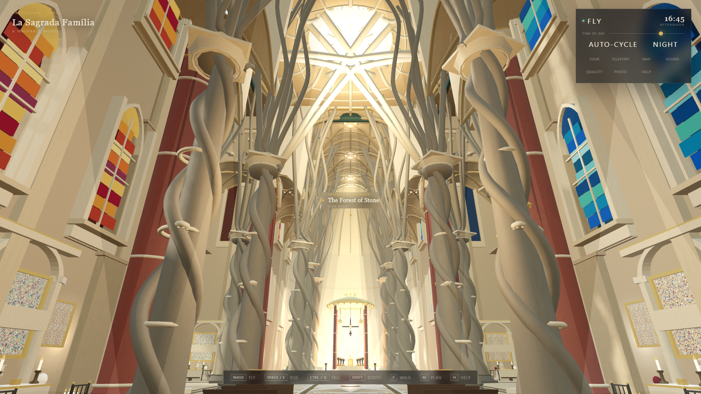

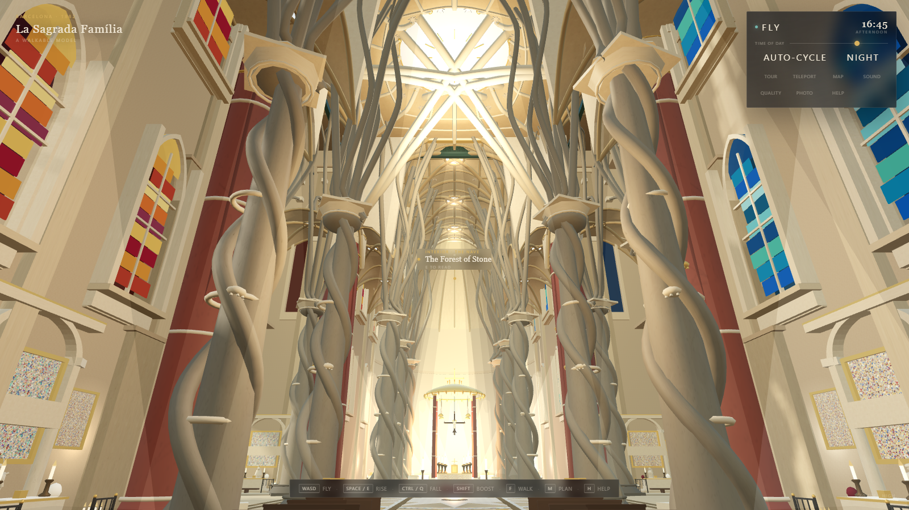

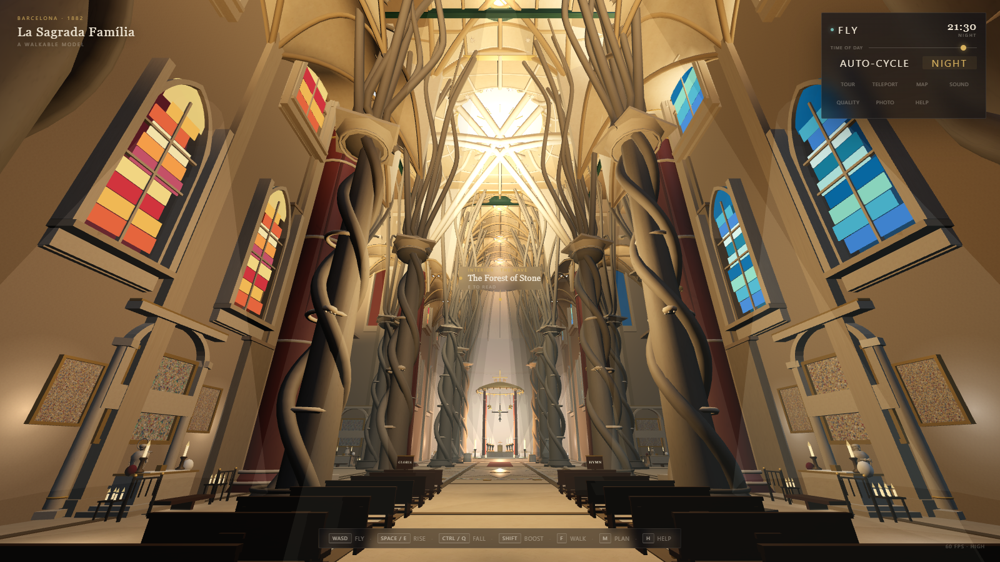

### Façade identity is clearly differentiated — STRENGTH

Nativity (03) reads warm and organic: cypress/tree-of-life greenery, vines, mosaic band, side roses. Passion (04) is deliberately grey, angular and austere with graphic niches. Glory (stops/05-glory, 05-facade-glory) owns the largest rose window with the strongest saturated glass. Theme (a) is satisfied.

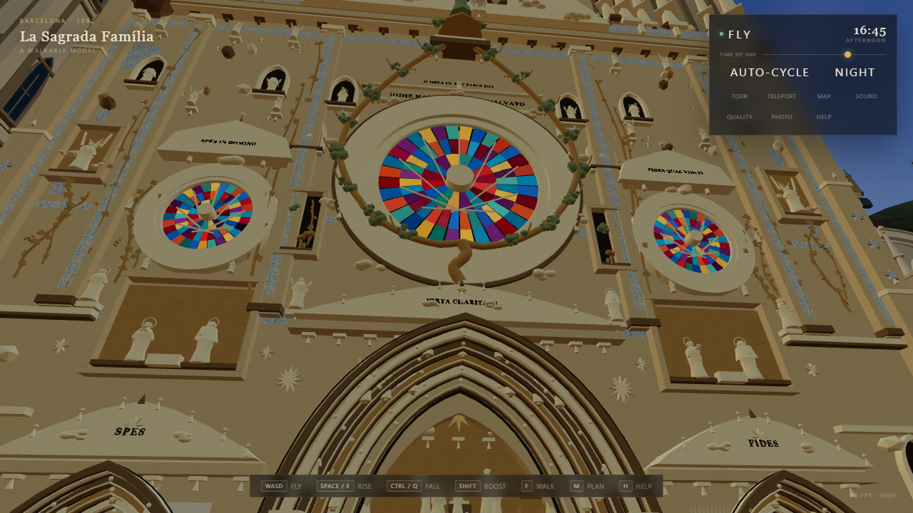

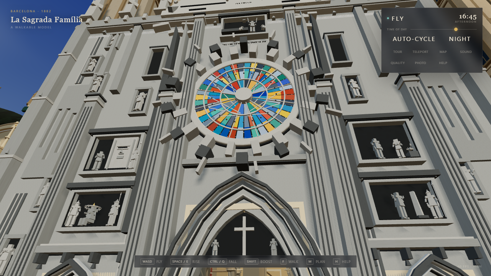

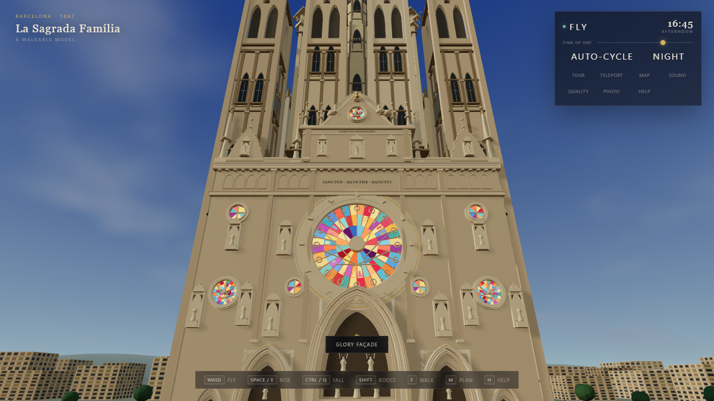

### Tower silhouette and the gold cross land — STRENGTH

From the plaza (stops/01-plaza), above the towers (10-towers) and from the air (11-aerial-plan), the twelve apostle towers + evangelist towers + Virgin star + the great gold cross of Jesus read as a mountain range. The cross is legible and unmistakable from most angles. Theme (b) is satisfied.

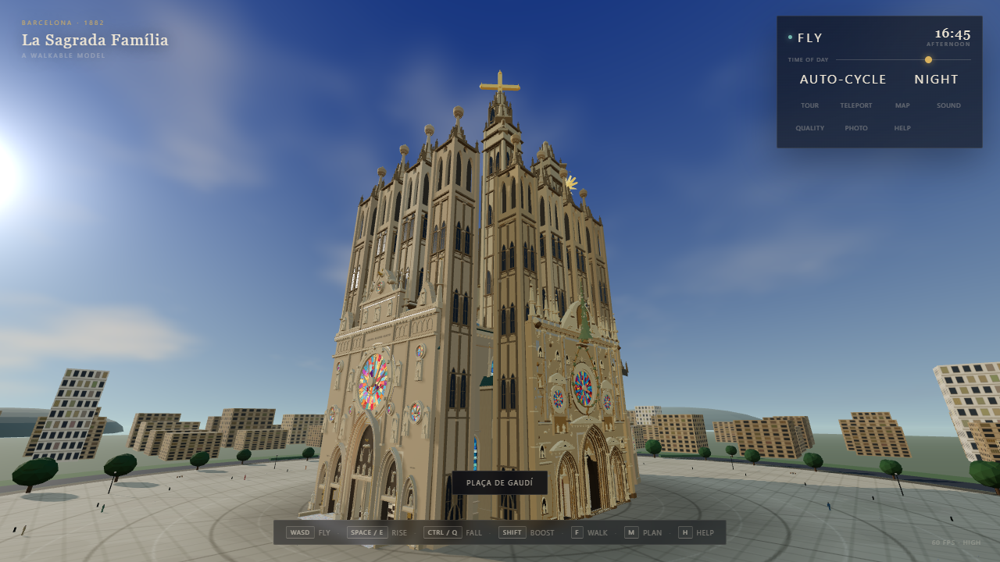

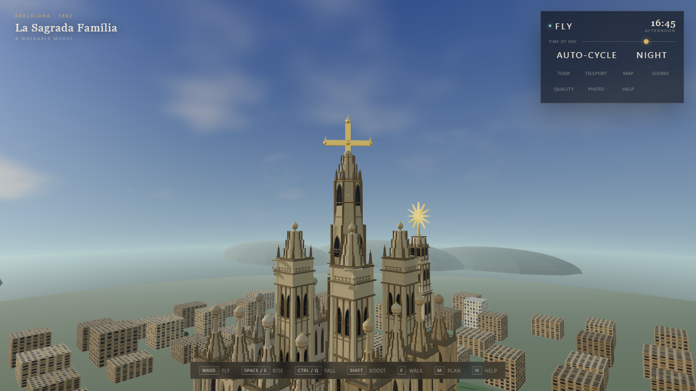

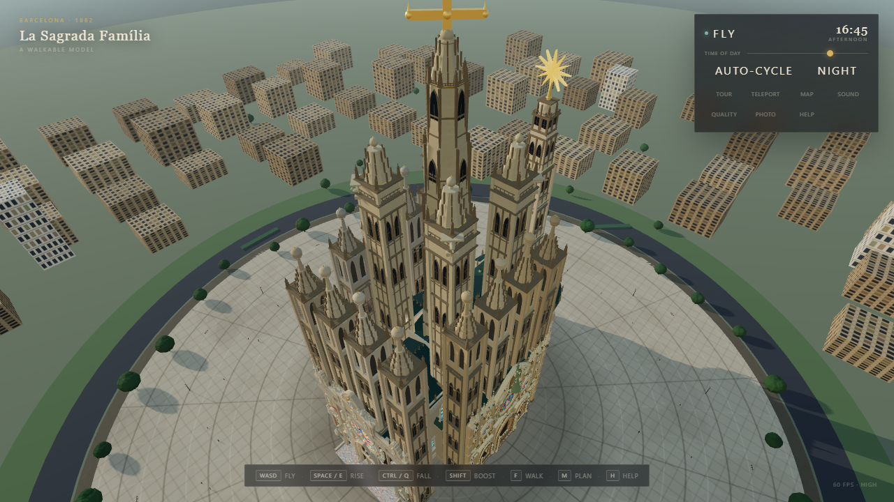

### Daylight interior is over-bright and flat — MINOR

Interior frames average ~143/255 luminance with max 255: the stone is chalky, shadow detail is thin and the stained glass struggles against the ambient. Carved capitals and vault ribs lose definition compared with the night render. A slightly lower exposure / stronger sun-vs-ambient contrast would restore depth.

### Night exterior is atmospheric but crops the crown — MINOR

The warm floodlit façade against stars and orange city windows works well, but the hero night frame cuts the tower of Jesus and its cross at the top edge and leaves the upper towers underlit. A pulled-back night framing would show the intended lantern-like silhouette.

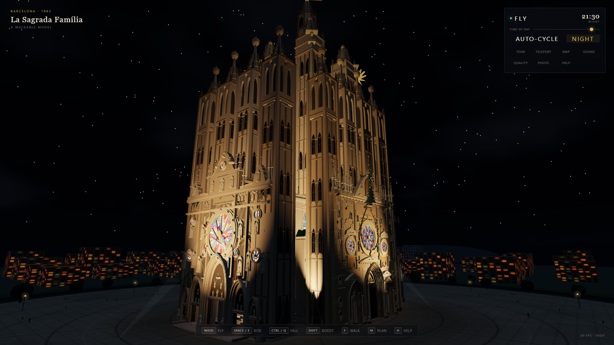

### City backdrop is placeholder-grade — MINOR

The Eixample reads as repeating beige boxes with painted window stripes on a flat green plate; the distant 'hills' appear as floating dark ellipses/plates and there is a straight seam across the sky in the aerial. Roads, block variety and a believable ground plane would greatly improve the sense of place and scale.

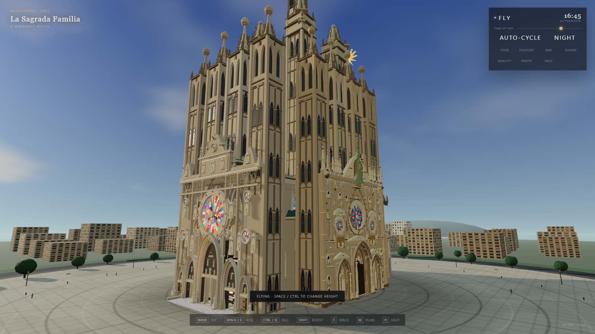

### Authored framings crop the best features — MINOR

Façade close-ups (03/04/05) are framed tight so the top of the façade and its towers are cut, and the plaza/context disappears; the Glory tour stop cuts the apostle towers above the rose. The interior hero poses are good. Pulling exterior stops back 15–25% would show composition rather than detail alone.

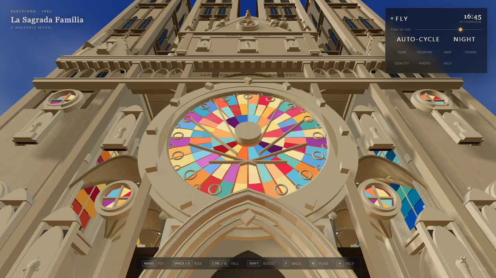

### Plan panel wastes its canvas — MINOR

The ground-plan drawing occupies roughly the central fifth of a large dark panel; labels and the 50 m scale bar are tiny and most of the panel is empty. Fitting the plan to the panel and enlarging the stop markers would make the minimap genuinely useful.

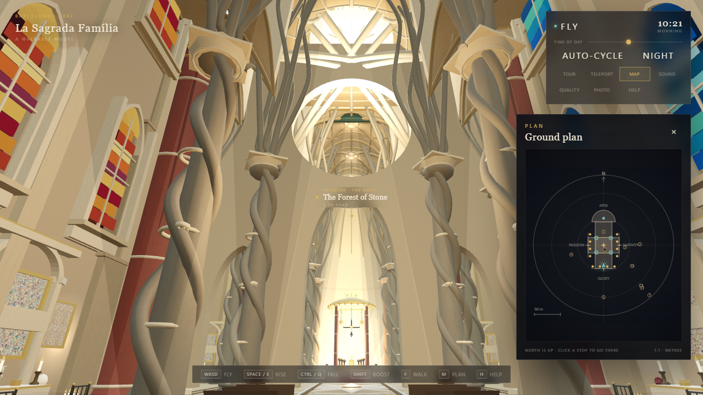

### Captions, cards and HUD are legible — STRENGTH

Tour captions (14) are readable with a clear stop index and kicker; hotspot cards (15) are well composed and legible; the narrow 800×500 HUD (19) keeps mode/clock/menu visible with no overflow (hotspot label wraps to four lines but remains readable). Theme (d)/(e) legibility is satisfied.

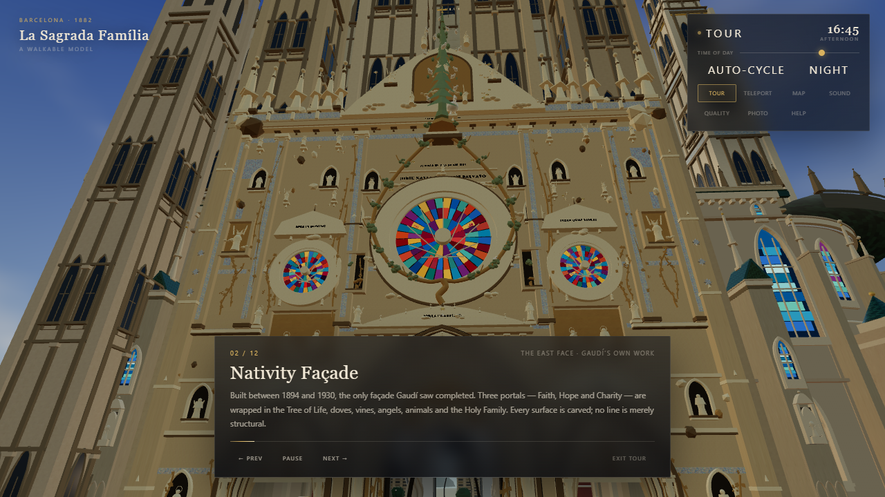

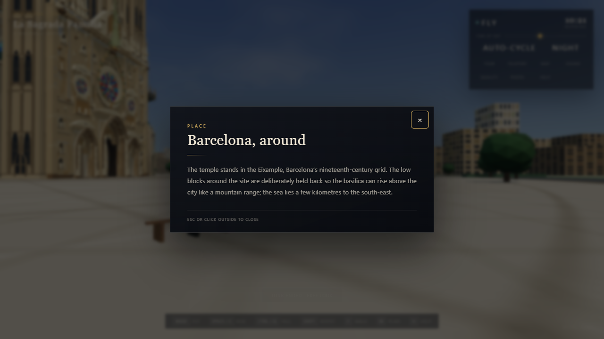

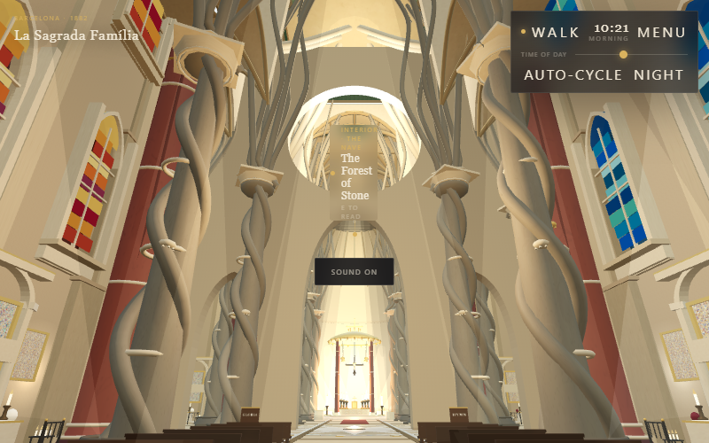

## Coverage and limitations

What this harness verifies automatically:
- boot through the real app, builder error surface (`window.__sagrada.errors()`), all five builder groups present
- splash UI and the "Enter on foot" path
- walking, eye height, jump, collision against the Nativity façade wall / apostle tower / crossing column
- passability of the three open façade doors (Nativity, Passion, Glory)
- fly mode toggle, rise and boost
- `teleport()` to every TOUR stop, plus screenshots of every stop (1280×720) and five hero frames (1600×900)
- guided tour start / advance / pause / exit and captions
- hotspot reticle, E-to-open info card and Escape to close
- day/night state (`env.time`, `env.night`, HUD clock, slider) and non-black night render
- plan/minimap, help, photo mode, `hideUI`, quality low/high, sound toggle presence, HUD overflow
- the documented QA URL parameters (skipSplash, mode, pos, look, time, ui, tour, photo)
- **Mobile section:** dropped from this final run per user request; independently verified by the Lead — ready/uiReady true, 390×844 canvas, touch UI active, no errors (`qa/mobile-check.png`, `qa/mobile-check.txt`).
- frame rate / draw calls / triangles at key poses (final-build fast pass) and per TOUR stop (full matrix run)
- console errors, uncaught page errors and failed requests across the run

What the fast-pass final artifacts cover (recorded in `meta.fastPassNotes`):
- boot, all five builder groups, builder-error surface and a full NaN/Inf geometry scan on the final build
- final-build captures: 06-nave-interior, 07-crossing, 08-altar, 13-night-interior, 14-tour-caption and all 12 TOUR stops
- note: the interaction matrix and the remaining exterior/UI captures were produced on the build immediately before the final Glory-wall transform fix; the cross-cutting functional results stand, and the affected interior/exterior hero frames were re-shot on the final build.

Not covered (impossible or deliberately out of scope in headless QA):
- **Audio output** — headless Edge has no audible device; only the mute toggle state is checked.
- **Pointer lock** — headless browsers deny it; the drag-look fallback is exercised instead, and a manual desktop pass should confirm mouse capture.
- **Real-GPU visual quality at full window size** — captures are headless (hero 1600×900, stops 1280×720); tone mapping/shadows are GPU-correct but a human should confirm on a desktop session.
- **Subjective art direction** — an automated harness can prove a frame is not black, not that it is beautiful; see the visual review section.
- **Long-play stress** — memory growth over a prolonged session is not measured.
- **Cross-browser** — Edge/Chromium only.
- **Collision completeness** — only three representative colliders are probed; a full collider audit is not attempted.

---
_Generated by `qa/verify/harness.mjs` at 2026-10-17T12:02:42.279Z. Machine-readable results: `qa/verify/results.json`. Curated notes: `qa/verify/visual-notes.json`._
